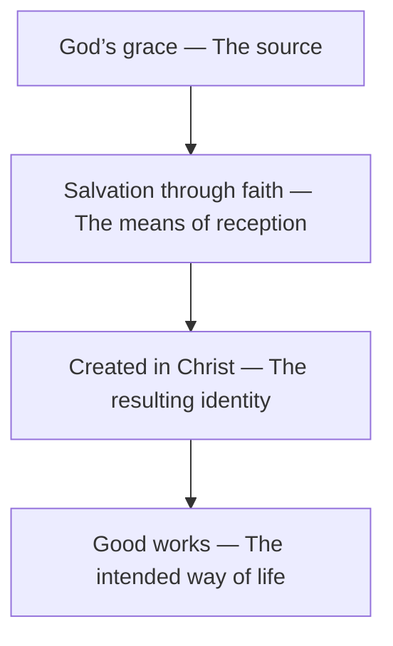
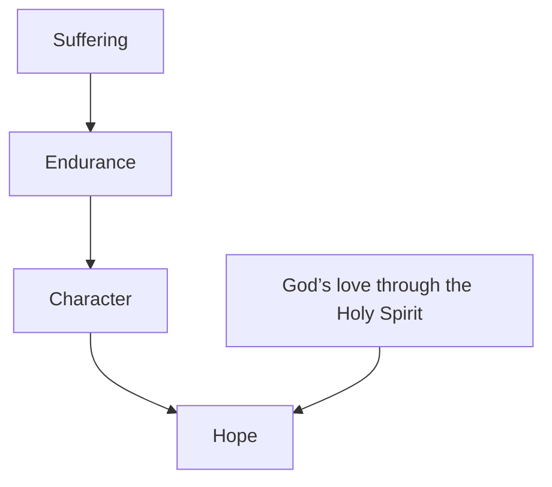
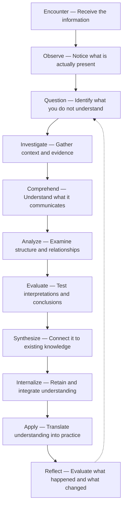

# Scripture study taxonomy: complete supplied baseline

## Scope and source status

The long-term product requirement includes all **82 categories, 4,588 category-list entries, and extensible combinations** in the supplied reconstruction. There are 23 parts: parts I–XIX contain categories 1–81; part XX contains category 82 and the composition calculator; parts XXI–XXIII add the learning lifecycle, objective-to-method mappings, and recommended approaches. Category 82 has no category-list entries: its six generator axes contain **82 selectable options** separately from the 4,588 catalog entries. There are also 24 objective-to-method pairs and 10 recommended approaches.

The user supplied Markdown, JSON, and HTML versions on 2026-11-24. Each explicitly identifies itself as a **manual reconstruction, not independently verified against a direct transcript**, with recreated interactive elements. That caveat is retained below. All 743 complete bullets in the previously available 20,000-character original-conversation excerpt match the beginning of this reconstruction exactly and in order. This verifies the overlap; it does not establish original-transcript fidelity for the remaining material.

All 82 category titles and category-list entries agree between the supplied Markdown and JSON. Static parsing of the supplied HTML independently confirms all 4,588 category-list entries and all 82 generator options. The full supplied baseline is now documented; direct-transcript comparison remains [D01](DECISIONS.md#open-decisions). No missing categories have been generated by this documentation task.

Before publication, one paragraph referring to the user's prior conversation topics was removed and its personalized part heading generalized. All category titles, entries, method descriptions, cautions, diagrams, lifecycle, objective mappings, and recommended methods are retained. A sentence directing readers to the HTML edition is clarified because that file remains local. The three original HTML study prototypes and all their embedded assets remain unpublished. The supplied taxonomy HTML is likewise not uploaded or executed.

## Stable references, data, and coverage

- Category IDs are `T01`–`T82`; each source entry has a stable ID such as `T01-E001` in the [machine-readable registry](taxonomy/registry.json). IDs follow supplied order, preserve duplicate labels across categories, and must not be renumbered when extending the baseline.
- The [coverage register](TAXONOMY_COVERAGE.md) maps all 82 categories and every entry by inheritance to requirements and delivery milestones. All implementation states start **planned**; documentation completeness does not mean product support.
- The registry retains source fingerprints, the reconstruction warning, source-ordered blocks, diagrams, generator axes/defaults/depths, calculator axes, learning lifecycle, objective mappings, and recommended approaches. Source category membership stays distinct from dimension tags.
- Source recovery, artifact consistency, original-transcript fidelity, implementation, and verification are separate measures. The supplied baseline denominator is known; fidelity beyond the verified overlap is not. Do not describe the reconstruction as a certified verbatim transcript or infer educational effectiveness from inclusion.
- New methods use versioned namespaced IDs, multiple memberships, definitions, prerequisites, evidence, accessible alternatives, and explicit migration/retirement records. Preserve this 82-category baseline when reorganizing later taxonomies.
- Combinations are generated on demand with compatibility/prerequisite checks and bounded results. A mathematical product counts candidate tuples, not proven coherent methods. The example generator's six axes yield 5,744,640 tuples before constraints; it is not a completeness claim.

## Supplied source fingerprints

| File retained locally | Bytes | SHA-256 |
| --- | --- | --- |
| `study-taxonomy.json` | 419,014 | `67f6cdd57ddf5d20a1dcdc5a7c030649e9a7a4c7796a9631994d336d477092ee` |
| `study-taxonomy.md` | 134,952 | `a75455ef4845cddcb14b749de7dec4a656ef5ce19a04199e9c11957a2b73a9f8` |
| `study-taxonomy.html` | 201,173 | `a2f0debec2261fa3b7c770c44a42b9ec2519d9b702d21bf630609b79d9021680` |

## Supplied taxonomy content, privacy-edited as described above

## Every way to study, learn, understand, and internalize information — with specific applications to Scripture

> Reconstructed from the original ChatGPT response (2026-11-24). Category and entry lists manually transcribed; not independently verified against a direct transcript. Interactive elements recreated.

Studying is much more than reading, memorizing, or listening to someone explain a subject. It encompasses virtually every deliberate way a person can encounter information, investigate it, understand it, challenge it, experience it, retain it, communicate it, and apply it.

Scripture introduces even more possibilities because it can be studied as literature, history, theology, philosophy, language, revelation, wisdom, moral instruction, spiritual formation, and a record of humanity's relationship with God.

There is no finite list of every possible study method because methods can be combined indefinitely. However, we can construct a comprehensive taxonomy that makes those possibilities discoverable and combinable.

I would distinguish the following dimensions:

| Dimension | Central question |
| --- | --- |
| Modality | Through what medium do I encounter information? |
| Method | What do I do with the information? |
| Framework | How do I organize my understanding? |
| Lens | From what perspective do I examine it? |
| Cognitive operation | What kind of thinking am I performing? |
| Representation | What form do I transform the information into? |
| Environment | Where and under what conditions do I study? |
| Participation | Who is involved in the learning? |
| Objective | What am I trying to accomplish? |
| Application | How does the information change what I do? |
| Evaluation | How do I determine whether I understand? |
| Integration | How does it connect with everything else I know? |

These categories are not mutually exclusive. For example, you could study Romans visually, using a logical argument map, through a historical lens, in a collaborative environment, with the objective of understanding Paul’s reasoning.

That combination constitutes its own study approach.

## Part I — General study modalities

### 1. Visual modalities

- Reading text
- Viewing photographs
- Viewing illustrations
- Viewing paintings
- Viewing diagrams
- Viewing infographics
- Viewing flowcharts
- Viewing mind maps
- Viewing concept maps
- Viewing knowledge graphs
- Viewing decision trees
- Viewing organizational charts
- Viewing timelines
- Viewing geographic maps
- Viewing topographical maps
- Viewing architectural drawings
- Viewing technical schematics
- Viewing cross-sections
- Viewing exploded diagrams
- Viewing symbolic representations
- Viewing pictograms
- Viewing icons
- Viewing tables
- Viewing matrices
- Viewing scatterplots
- Viewing line graphs
- Viewing bar graphs
- Viewing heat maps
- Viewing Venn diagrams
- Viewing animations
- Viewing motion graphics
- Viewing documentaries
- Viewing demonstrations
- Viewing simulations
- Viewing silent films
- Viewing subtitled films
- Viewing comic strips
- Viewing graphic novels
- Viewing storyboards
- Viewing color-coded information
- Viewing spatial arrangements
- Viewing three-dimensional models
- Viewing microscopic imagery
- Viewing augmented reality
- Viewing virtual reality
- Viewing comparative images
- Viewing before-and-after representations
- Viewing annotated imagery
- Visual pattern recognition
- Visual sequencing
- Visual association
- Visual memorization
- Visual reconstruction
- Visual abstraction
- Visual metaphor
- Mental visualization
- Guided imagery
- Spatial visualization
- Data visualization

### 2. Auditory modalities

- Listening to lectures
- Listening to audiobooks
- Listening to podcasts
- Listening to conversations
- Listening to interviews
- Listening to debates
- Listening to sermons
- Listening to oral histories
- Listening to storytelling
- Listening to dramatic readings
- Listening to narrated explanations
- Listening to panel discussions
- Listening to recorded lessons
- Listening to live instruction
- Listening to question-and-answer sessions
- Listening to musical compositions
- Listening to instructional songs
- Listening to chanting
- Listening to rhythmic recitation
- Listening to poetry
- Listening to repeated phrases
- Listening to multiple speakers
- Listening to conflicting interpretations
- Listening to pronunciation
- Listening to phonetic demonstrations
- Listening to different accents
- Listening to environmental sounds
- Listening to sound-based simulations
- Listening while reading
- Listening while walking
- Listening while performing another activity
- Listening at reduced playback speed
- Listening at accelerated playback speed
- Repeated listening
- Segmented listening
- Reflective listening
- Analytical listening
- Critical listening
- Immersive listening
- Call-and-response learning
- Oral repetition
- Verbal memorization
- Sound association
- Audio mnemonics
- Audio journaling
- Self-recorded explanations
- Conversational explanation
- Thinking aloud

### 3. Reading and textual modalities

- Silent reading
- Reading aloud
- Whisper reading
- Intensive reading
- Extensive reading
- Close reading
- Slow reading
- Speed reading
- Skimming
- Scanning
- Survey reading
- Preview reading
- Sequential reading
- Nonsequential reading
- Recursive reading
- Repeated reading
- Comparative reading
- Parallel-text reading
- Critical reading
- Reflective reading
- Analytical reading
- Interpretive reading
- Literal reading
- Contextual reading
- Thematic reading
- Chronological reading
- Genre-based reading
- Question-driven reading
- Problem-driven reading
- Research-driven reading
- Annotation-based reading
- Margin-note reading
- Highlight-based reading
- Keyword-focused reading
- Sentence-by-sentence reading
- Phrase-by-phrase reading
- Word-by-word reading
- Paragraph-by-paragraph reading
- Chapter-by-chapter reading
- Whole-book reading
- Primary-source reading
- Secondary-source reading
- Tertiary-source reading
- Reference reading
- Encyclopedia reading
- Dictionary reading
- Technical reading
- Scholarly reading
- Popular-level reading
- Narrative reading
- Poetry reading
- Instructional reading
- Argumentative reading
- Philosophical reading
- Linguistic reading
- Intertextual reading
- Hypertext reading
- Digital reading
- Printed-text reading
- Large-print reading
- Plain-language reading
- Interlinear reading
- Bilingual reading
- Multilingual reading
- Translated-text reading
- Original-language reading

### 4. Writing modalities

- Handwritten note-taking
- Typed note-taking
- Verbatim transcription
- Selective transcription
- Copywork
- Dictation
- Outlining
- Summarization
- Paraphrasing
- Rewriting
- Simplifying
- Expanding
- Defining terms
- Constructing glossaries
- Writing abstracts
- Writing essays
- Writing research papers
- Writing reflections
- Writing journals
- Writing arguments
- Writing counterarguments
- Writing questions
- Writing answers
- Writing explanations
- Writing letters
- Writing dialogues
- Writing fictional scenarios
- Writing case studies
- Writing analogies
- Writing metaphors
- Writing poems
- Writing songs
- Writing scripts
- Writing stories
- Writing instructions
- Writing tutorials
- Writing textbooks
- Writing commentaries
- Writing critiques
- Writing reviews
- Writing hypotheses
- Writing predictions
- Writing observations
- Writing personal applications
- Writing action plans
- Writing definitions from memory
- Writing summaries from memory
- Freewriting
- Stream-of-consciousness writing
- Reflective journaling
- Structured journaling
- Bullet journaling
- Cornell note-taking
- Outline note-taking
- Charting note-taking
- Sentence-method note-taking
- Mapping note-taking
- Zettelkasten note-taking
- Atomic note-taking
- Progressive summarization
- Commonplace-book keeping
- Knowledge-base construction
- Collaborative writing
- Peer editing
- Iterative revision

### 5. Kinesthetic and embodied modalities

- Learning by doing
- Physical demonstration
- Physical imitation
- Physical rehearsal
- Gesture-based learning
- Movement-based memorization
- Walking while studying
- Pacing while reciting
- Acting out concepts
- Role-playing
- Performing procedures
- Manipulating physical objects
- Assembling models
- Disassembling models
- Building prototypes
- Experimenting physically
- Drawing by hand
- Painting
- Sculpting
- Crafting
- Tracing
- Sorting physical cards
- Arranging objects spatially
- Constructing physical diagrams
- Using manipulatives
- Conducting laboratory experiments
- Participating in fieldwork
- Participating in workshops
- Practicing rituals
- Learning through dance
- Learning through exercise
- Learning through physical navigation
- Recreating historical practices
- Experiencing reconstructed environments
- Practicing skills in context
- Participating in simulations
- Repeating physical routines
- Muscle-memory development
- Embodied metaphor
- Somatic awareness
- Sensory exploration

### 6. Verbal and conversational modalities

- Asking questions
- Answering questions
- Explaining concepts aloud
- Teaching another person
- Giving presentations
- Participating in discussions
- Participating in debates
- Participating in interviews
- Participating in seminars
- Participating in oral examinations
- Participating in Socratic dialogue
- Participating in philosophical dialogue
- Participating in collaborative inquiry
- Participating in storytelling
- Participating in oral interpretation
- Verbalizing observations
- Verbalizing assumptions
- Verbalizing logical steps
- Verbalizing misunderstandings
- Verbalizing personal experiences
- Thinking aloud
- Talking through a problem
- Talking through contradictions
- Rubber-duck explanation
- Conversational tutoring
- Peer tutoring
- Reciprocal teaching
- Oral summarization
- Oral paraphrasing
- Oral reconstruction
- Oral translation
- Oral recitation
- Oral argumentation
- Oral reflection
- Oral defense of a position
- Improvised explanation
- Scripted explanation
- Question-led conversation
- Artificial-intelligence dialogue

### 7. Multisensory and mixed-media modalities

- Reading while listening
- Reading while annotating
- Reading while drawing
- Reading while speaking
- Reading while walking
- Listening while visualizing
- Listening while writing
- Listening while drawing
- Listening while manipulating objects
- Watching while taking notes
- Watching while imitating
- Watching while discussing
- Watching while experimenting
- Speaking while diagramming
- Speaking while demonstrating
- Writing while explaining
- Drawing while explaining
- Music-assisted memorization
- Rhythm-assisted memorization
- Gesture-assisted memorization
- Color-assisted categorization
- Spatial-assisted memorization
- Object-assisted storytelling
- Tactile learning
- Haptic learning
- Braille reading
- Sign-language instruction
- Audio-described instruction
- Interactive multimedia
- Immersive virtual reality
- Augmented-reality instruction
- Mixed-reality instruction
- Multimodal storytelling
- Multimodal presentations
- Multisensory environments
- Physical-digital hybrid learning
- Interactive simulations

These are ways of accessing and processing information, not fixed categories of people. A person can benefit from different modalities depending on the material and the objective; there is no need to identify exclusively as a visual, auditory, or kinesthetic learner.

## Part II — Cognitive operations

These describe what your mind actually does with information, regardless of the medium through which you receive it.

### 8. Observation and information acquisition

- Noticing
- Observing
- Identifying
- Recognizing
- Detecting
- Locating
- Discovering
- Extracting
- Gathering
- Collecting
- Recording
- Describing
- Listing
- Enumerating
- Naming
- Labeling
- Measuring
- Counting
- Tracking
- Monitoring
- Surveying
- Inspecting
- Examining
- Investigating
- Searching
- Exploring
- Sampling
- Cataloging
- Inventorying
- Documenting
- Transcribing
- Capturing
- Retrieving
- Recalling
- Recognizing patterns
- Recognizing anomalies
- Identifying omissions
- Identifying repetitions
- Identifying emphasis
- Identifying boundaries
- Identifying transitions
- Identifying relationships
- Identifying dependencies
- Identifying assumptions

### 9. Comprehension

- Defining
- Clarifying
- Explaining
- Interpreting
- Decoding
- Translating
- Paraphrasing
- Restating
- Summarizing
- Simplifying
- Elaborating
- Expanding
- Exemplifying
- Illustrating
- Demonstrating
- Contextualizing
- Disambiguating
- Generalizing
- Specifying
- Distinguishing
- Differentiating
- Categorizing
- Classifying
- Associating
- Connecting
- Sequencing
- Ordering
- Relating
- Inferring
- Predicting
- Interpolating
- Extrapolating
- Reconstructing
- Identifying significance
- Identifying purpose
- Identifying intent
- Identifying implications
- Identifying consequences
- Identifying underlying principles
- Understanding explicit meaning
- Understanding implicit meaning
- Understanding symbolic meaning
- Understanding contextual meaning
- Understanding pragmatic meaning

### 10. Analysis

- Decomposition
- Segmentation
- Structural analysis
- Functional analysis
- Component analysis
- Dependency analysis
- Hierarchical analysis
- Sequential analysis
- Relational analysis
- Comparative analysis
- Contrastive analysis
- Causal analysis
- Root-cause analysis
- Pattern analysis
- Trend analysis
- Contextual analysis
- Historical analysis
- Linguistic analysis
- Semantic analysis
- Pragmatic analysis
- Syntactic analysis
- Morphological analysis
- Phonological analysis
- Statistical analysis
- Quantitative analysis
- Qualitative analysis
- Thematic analysis
- Narrative analysis
- Discourse analysis
- Rhetorical analysis
- Argument analysis
- Logical analysis
- Systems analysis
- Network analysis
- Process analysis
- Temporal analysis
- Spatial analysis
- Comparative framework analysis
- Assumption analysis
- Implication analysis
- Contradiction analysis
- Error analysis
- Failure analysis
- Exception analysis
- Boundary-condition analysis
- Sensitivity analysis
- Counterfactual analysis
- Context-window analysis
- Evidence analysis
- Source analysis
- Reliability analysis

### 11. Reasoning

- Deductive reasoning
- Inductive reasoning
- Abductive reasoning
- Analogical reasoning
- Causal reasoning
- Conditional reasoning
- Propositional reasoning
- Predicate reasoning
- Categorical reasoning
- Syllogistic reasoning
- Boolean reasoning
- Probabilistic reasoning
- Bayesian reasoning
- Statistical reasoning
- Mathematical reasoning
- Spatial reasoning
- Temporal reasoning
- Ethical reasoning
- Moral reasoning
- Philosophical reasoning
- Theological reasoning
- Historical reasoning
- Legal reasoning
- Scientific reasoning
- Narrative reasoning
- Contextual reasoning
- Dialectical reasoning
- Counterfactual reasoning
- Hypothetical reasoning
- Counterexample reasoning
- First-principles reasoning
- Second-order reasoning
- Higher-order reasoning
- Recursive reasoning
- Backward reasoning
- Forward reasoning
- Means-end reasoning
- Constraint-based reasoning
- Model-based reasoning
- Case-based reasoning
- Rule-based reasoning
- Mechanistic reasoning
- Systems reasoning
- Decision-theoretic reasoning
- Practical reasoning
- Abstract reasoning
- Concrete reasoning
- Intuitive reasoning
- Reflective reasoning
- Metacognitive reasoning
- Defeasible reasoning
- Nonmonotonic reasoning
- Modal reasoning
- Reasoning by elimination
- Reasoning from necessary conditions
- Reasoning from sufficient conditions
- Reasoning from exceptions
- Reasoning from principles
- Reasoning from consequences

### 12. Evaluation and verification

- Fact-checking
- Source verification
- Cross-referencing
- Triangulation
- Corroboration
- Replication
- Reproducibility testing
- Falsification
- Hypothesis testing
- Counterexample testing
- Stress testing
- Assumption testing
- Consistency checking
- Internal consistency checking
- External consistency checking
- Plausibility assessment
- Probability assessment
- Credibility assessment
- Reliability assessment
- Validity assessment
- Relevance assessment
- Bias detection
- Fallacy detection
- Contradiction detection
- Ambiguity detection
- Uncertainty assessment
- Evidence weighting
- Argument evaluation
- Premise evaluation
- Conclusion evaluation
- Alternative explanation testing
- Competing hypothesis comparison
- Adversarial review
- Peer review
- Expert review
- Self-review
- Historical verification
- Experimental verification
- Empirical verification
- Logical verification
- Comparative verification
- Contextual verification
- Methodological critique
- Source criticism
- Confidence calibration
- Intellectual humility
- Judgment suspension
- Error correction

### 13. Synthesis and creation

- Combining
- Integrating
- Synthesizing
- Consolidating
- Unifying
- Reconciling
- Harmonizing
- Generalizing
- Abstracting
- Modeling
- Reconstructing
- Reorganizing
- Restructuring
- Reframing
- Redesigning
- Reinterpreting
- Repurposing
- Transforming
- Composing
- Constructing
- Designing
- Inventing
- Generating hypotheses
- Generating explanations
- Generating analogies
- Generating metaphors
- Generating examples
- Generating counterexamples
- Generating questions
- Generating alternative models
- Building conceptual frameworks
- Building theoretical frameworks
- Building mental models
- Building taxonomies
- Building ontologies
- Building classifications
- Building systems
- Building narratives
- Building arguments
- Building decision frameworks
- Building procedural frameworks
- Building knowledge networks
- Creating instructional materials
- Creating new interpretations
- Creating integrated worldviews
- Creating practical applications

## Part III — Formal study methodologies

### 14. Memory and retention methods

- Active recall
- Free recall
- Cued recall
- Recognition practice
- Retrieval practice
- Spaced repetition
- Distributed practice
- Massed practice
- Expanding-interval repetition
- Fixed-interval repetition
- Flashcard study
- Leitner system
- Cloze deletion
- Fill-in-the-blank exercises
- Question-answer memorization
- Keyword mnemonics
- Acronym mnemonics
- Acrostic mnemonics
- Rhyming mnemonics
- Musical mnemonics
- Image mnemonics
- Narrative mnemonics
- Association chains
- Memory palace
- Method of loci
- Pegword system
- Major mnemonic system
- Person-action-object system
- Chunking
- Information compression
- Information grouping
- Repeated recitation
- Cumulative recitation
- First-letter memorization
- Progressive word removal
- Backward chaining
- Forward chaining
- Serial learning
- Paired-associate learning
- Overlearning
- Generation effect
- Testing effect
- Elaborative encoding
- Semantic encoding
- Visual encoding
- Auditory encoding
- Motor encoding
- Contextual encoding
- Dual coding
- Drawing from memory
- Reconstructing diagrams from memory
- Explaining from memory
- Blank-page recall
- Brain dumping
- Blurting method
- Delayed recall
- Interference management
- Memory consolidation
- Interleaved practice
- Blocked practice
- Variable practice
- Cumulative review

### 15. Structured study systems

- SQ3R — Survey, Question, Read, Recite, Review
- SQ4R — Survey, Question, Read, Reflect, Recite, Review
- SQ5R
- PQ4R — Preview, Question, Read, Reflect, Recite, Review
- PQRST — Preview, Question, Read, Self-recite, Test
- KWL — Know, Want to know, Learned
- KWHL — Know, Want to know, How to learn, Learned
- OK4R
- Feynman technique
- Cornell study system
- Zettelkasten method
- Concept mapping
- Mind mapping
- Cognitive mapping
- Argument mapping
- Question mapping
- Knowledge graphing
- Progressive summarization
- Deliberate practice
- Mastery learning
- Competency-based learning
- Spiral learning
- Scaffolding
- Worked-example study
- Example-problem pairs
- Faded-guidance practice
- Guided discovery
- Independent discovery
- Inquiry-based learning
- Problem-based learning
- Project-based learning
- Challenge-based learning
- Case-based learning
- Scenario-based learning
- Simulation-based learning
- Game-based learning
- Experiential learning
- Phenomenon-based learning
- Research-based learning
- Design-based learning
- Task-based learning
- Question-based learning
- Evidence-based learning
- Conversation-based learning
- Narrative-based learning
- Context-based learning
- Place-based learning
- Service learning
- Action learning
- Reflective learning
- Transformative learning
- Situated learning
- Self-directed learning
- Self-regulated learning
- Personalized learning
- Adaptive learning
- Programmed instruction
- Direct instruction
- Explicit instruction
- Montessori-inspired learning
- Charlotte Mason narration
- Classical trivium
- Classical quadrivium
- Socratic method
- Dialectical method
- Scientific method
- Flipped classroom
- Microlearning
- Macrolearning
- Just-in-time learning
- Immersion learning
- Apprenticeship learning
- Cognitive apprenticeship
- Universal Design for Learning
- Backward design

### 16. Question-driven methods

- Socratic questioning
- Open-ended questioning
- Closed-ended questioning
- Clarifying questions
- Probing questions
- Diagnostic questions
- Reflective questions
- Evaluative questions
- Hypothetical questions
- Counterfactual questions
- Comparative questions
- Contrastive questions
- Definitional questions
- Causal questions
- Consequential questions
- Procedural questions
- Contextual questions
- Historical questions
- Interpretive questions
- Critical questions
- Application questions
- Ethical questions
- Philosophical questions
- Foundational questions
- Existential questions
- Epistemological questions
- Ontological questions
- Teleological questions
- Metacognitive questions
- Sequential questioning
- Recursive questioning
- Question decomposition
- Question formulation technique
- Five Whys
- Five Ws and How
- What-if analysis
- What-is-missing analysis
- What-would-disprove-this analysis
- Necessary-condition questioning
- Sufficient-condition questioning
- Reverse questioning
- Assumption questioning
- Premise questioning
- Implication questioning
- Boundary questioning
- Exception questioning
- Question trees
- Question ladders
- Question matrices
- Question journals
- Question-and-answer dialogues

### 17. Experimental and investigative methods

- Controlled experimentation
- Natural experimentation
- Thought experimentation
- Field experimentation
- Laboratory experimentation
- Observation studies
- Participant observation
- Ethnography
- Autoethnography
- Case studies
- Comparative case studies
- Longitudinal studies
- Cross-sectional studies
- Historical investigation
- Archival research
- Documentary research
- Literature review
- Systematic review
- Scoping review
- Meta-analysis
- Content analysis
- Thematic coding
- Grounded theory
- Phenomenological inquiry
- Survey research
- Interview research
- Focus groups
- Action research
- Participatory research
- Exploratory research
- Explanatory research
- Descriptive research
- Correlational research
- Replication studies
- Exploratory data analysis
- Confirmatory analysis
- Scenario analysis
- Model construction
- Model validation
- Simulation
- Reverse engineering
- Benchmarking
- Comparative testing
- Failure reconstruction
- Forensic investigation
- Evidence reconstruction

## Part IV — Representation and transformation methods

One of the most powerful ways to study something is to change its representation. Information that seems confusing in paragraph form might become obvious when transformed into a decision tree, timeline, graph, or dialogue.

### 18. Diagrammatic representations

- Flowchart
- Process diagram
- Logic diagram
- Argument map
- Decision tree
- Fault tree
- Event tree
- Issue tree
- Question tree
- Problem tree
- Concept map
- Mind map
- Semantic map
- Knowledge graph
- Entity-relationship diagram
- Dependency graph
- Directed graph
- Undirected graph
- Network graph
- Causal loop diagram
- Causal chain
- Influence diagram
- Systems diagram
- Stock-and-flow diagram
- Feedback-loop diagram
- State-machine diagram
- State-transition diagram
- Sequence diagram
- Activity diagram
- Use-case diagram
- Swimlane diagram
- SIPOC diagram
- Block diagram
- Functional diagram
- Hierarchical diagram
- Organizational chart
- Taxonomy tree
- Ontology graph
- Genealogical tree
- Family tree
- Venn diagram
- Euler diagram
- Set diagram
- Fishbone diagram
- Spider diagram
- Affinity diagram
- Relationship map
- Story map
- Journey map
- Empathy map
- Experience map
- Stakeholder map
- Geographic map
- Temporal map
- Spatial map
- Concentric-circle diagram
- Pyramid diagram
- Inverted pyramid
- Funnel diagram
- Cycle diagram
- Ladder diagram
- Matrix diagram
- Four-quadrant diagram
- Sankey diagram
- Chord diagram
- Treemap
- Sunburst diagram
- Dendrogram

### 19. Logical and mathematical representations

- Formal propositions
- Predicate statements
- Conditional statements
- Biconditional statements
- Truth tables
- Boolean expressions
- Logical equivalences
- Logical negations
- Syllogisms
- Symbolic logic
- Modal logic expressions
- Set notation
- Mathematical equations
- Inequalities
- Functions
- Matrices
- Vectors
- Graph-theoretic models
- Probability trees
- Bayesian networks
- Constraint models
- Necessary-condition models
- Sufficient-condition models
- Premise-conclusion structures
- Argument chains
- Proof trees
- Counterexample structures
- Decision tables
- Rule tables
- Pseudocode
- Algorithms
- Structured data
- Formal grammars
- Semantic triples
- Subject-predicate-object structures
- Axiomatic systems
- Logical dependency models

### 20. Textual transformations

- Original text to plain language
- Original text to modern language
- Original text to simplified vocabulary
- Original text to expanded vocabulary
- Original text to technical language
- Original text to conversational language
- Original text to academic language
- Original text to children's language
- Original text to bullet points
- Original text to numbered steps
- Original text to a hierarchy
- Original text to a table
- Original text to a checklist
- Original text to questions
- Original text to answers
- Original text to a glossary
- Original text to a dictionary
- Original text to a dialogue
- Original text to a debate
- Original text to an interview
- Original text to a screenplay
- Original text to a stage play
- Original text to a short story
- Original text to a poem
- Original text to a song
- Original text to a letter
- Original text to a memo
- Original text to a report
- Original text to a case study
- Original text to a procedural guide
- Original text to a manifesto
- Original text to a declaration
- Original text to an analogy
- Original text to a metaphor
- Original text to a hypothetical scenario
- Original text to a contemporary scenario
- Original text to a historical reconstruction
- Original text to flashcards
- Original text to a multiple-choice examination
- Original text to a fill-in-the-blank examination
- Original text to an oral examination
- Original text to a lesson plan
- Original text to a curriculum
- Original text to a research agenda
- Original text to a series of progressively detailed explanations
- Original text to a series of progressively simplified explanations

### 21. Creative and artistic representations

- Drawing
- Painting
- Illustration
- Sculpture
- Collage
- Photography
- Cinematography
- Documentary production
- Animation
- Stop-motion animation
- Motion graphics
- Graphic design
- Typography
- Iconography
- Symbol design
- Poster design
- Infographic design
- Architectural modeling
- Three-dimensional modeling
- Physical model construction
- Diorama construction
- Comic creation
- Graphic-novel creation
- Musical composition
- Songwriting
- Poetry composition
- Spoken-word performance
- Theater
- Improvisation
- Dance
- Choreography
- Sound design
- Audio drama
- Radio production
- Podcast production
- Storytelling
- Interactive fiction
- Video-game design
- Board-game design
- Card-game design
- Puzzle construction
- Escape-room construction
- World-building
- Virtual-world construction
- Immersive experience design
- Installation art

## Part V — Social, environmental, and technological study modalities

### 22. Individual and interpersonal study

- Independent study
- Solitary study
- Partner study
- Peer study
- Small-group study
- Large-group study
- Family study
- Intergenerational study
- Mentored study
- Coached study
- Tutored study
- Guided study
- Classroom study
- Seminar study
- Workshop study
- Lecture-based study
- Conference-based study
- Community-based study
- Collaborative study
- Cooperative study
- Competitive study
- Peer-instruction study
- Reciprocal teaching
- Expert consultation
- Interview-based study
- Master-apprentice study
- Accountability-partner study
- Learning circles
- Reading groups
- Book clubs
- Communities of practice
- Discussion forums
- Debate societies
- Study retreats
- Public lectures
- Online communities
- Correspondence learning
- Remote tutoring
- Asynchronous group learning
- Synchronous group learning
- Crowdsourced learning
- Artificial-intelligence-assisted study
- Human-AI collaborative study

### 23. Environmental and temporal study configurations

- Quiet study
- Silent study
- Background-music study
- Ambient-noise study
- Nature-based study
- Outdoor study
- Indoor study
- Library study
- Home study
- Workplace study
- Coffee-shop study
- Classroom study
- Laboratory study
- Museum study
- Field study
- Historical-site study
- Walking study
- Travel-based study
- Retreat-based study
- Immersive residential study
- Morning study
- Midday study
- Evening study
- Night study
- Short-burst study
- Extended-session study
- Timed study
- Untimed study
- Pomodoro study
- Time-blocked study
- Energy-based scheduling
- Deadline-driven study
- Opportunistic study
- Daily study
- Weekly study
- Monthly study
- Seasonal study
- Annual study
- Lifelong study
- Distributed study
- Intensive study
- Sequential study
- Parallel study
- Rotating-topic study
- Interleaved-topic study
- Context-dependent study
- Variable-context study

### 24. Digital and computational study

- Search-engine research
- Digital library research
- Electronic reference research
- Database querying
- Full-text searching
- Keyword searching
- Boolean searching
- Semantic searching
- Citation searching
- Citation-network analysis
- Digital annotation
- Collaborative annotation
- Hyperlink exploration
- Knowledge-base navigation
- Wiki construction
- Interactive notebooks
- Computational modeling
- Algorithmic analysis
- Programmatic text analysis
- Natural-language processing
- Text mining
- Corpus analysis
- Word-frequency analysis
- Concordance generation
- Collocation analysis
- N-gram analysis
- Topic modeling
- Named-entity recognition
- Sentiment analysis
- Stylometric analysis
- Text clustering
- Semantic similarity analysis
- Network visualization
- Automated translation comparison
- Digital flashcards
- Adaptive quizzes
- Interactive timelines
- Interactive maps
- Interactive diagrams
- Digital simulations
- Educational applications
- Learning management systems
- Personalized recommendation systems
- Artificial-intelligence tutoring
- Artificial-intelligence questioning
- Artificial-intelligence summarization
- Artificial-intelligence debate
- Artificial-intelligence role-playing
- Artificial-intelligence Socratic dialogue
- Artificial-intelligence translation assistance
- Artificial-intelligence argument mapping
- Artificial-intelligence knowledge graphing
- Artificial-intelligence curriculum generation
- Artificial-intelligence assessment
- Artificial-intelligence misconception detection
- Retrieval-augmented research
- Multimodal artificial-intelligence study

## Part VI — Every major approach to studying Scripture

Scripture study can be divided into several overlapping objectives: Exegesis (what does the text communicate in its original context?), Hermeneutics (how should the text be interpreted?), Theology (what does the text communicate about God, humanity, and reality?), Apologetics (what reasons support or challenge particular beliefs?), Spiritual formation (how does engagement with Scripture shape a person?), and Application (how should someone respond to what they understand?). These objectives should remain distinguishable. Understanding what an author meant, constructing a theological conclusion, and deciding how to live are related but different operations.

### 25. Scripture reading methods

- Whole-Bible reading
- Genesis-to-Revelation reading
- Old Testament reading
- New Testament reading
- Torah reading
- Pentateuch reading
- Historical-books reading
- Wisdom-literature reading
- Major-prophets reading
- Minor-prophets reading
- Gospel reading
- Pauline-epistle reading
- General-epistle reading
- Apocalyptic-literature reading
- Canonical-order reading
- Chronological-order reading
- Historical-order reading
- Probable composition-order reading
- Thematic-order reading
- Liturgical-order reading
- Lectionary reading
- Topical reading
- Random-access reading
- Book-by-book reading
- Chapter-by-chapter reading
- Passage-by-passage reading
- Paragraph-by-paragraph reading
- Sentence-by-sentence reading
- Clause-by-clause reading
- Phrase-by-phrase reading
- Verse-by-verse reading
- Word-by-word reading
- Letter-by-letter textual study
- Whole-book single-sitting reading
- Whole-book repeated reading
- Single-passage repeated reading
- Single-verse meditation
- Parallel-passage reading
- Cross-reference reading
- Translation-comparison reading
- Original-language reading
- Interlinear reading
- Reverse-interlinear reading
- Audio-Bible reading
- Dramatized-Bible listening
- Public Scripture reading
- Responsive Scripture reading
- Memorized Scripture recitation
- Reading without chapter divisions
- Reading without verse numbers
- Reading without section headings
- Reading without commentary
- Reading with commentary
- Reading with study notes
- Reading with a lexicon
- Reading with an atlas
- Reading with historical resources
- Reading with archaeological resources
- Reading with theological resources
- Reading with a running journal
- Reading through a particular question
- Reading through a particular doctrine
- Reading through a particular character
- Reading through a particular relationship
- Reading through a particular emotion
- Reading through a particular life circumstance

### 26. Established Bible study frameworks

- Inductive Bible study
- Deductive Bible study
- Abductive Bible study
- Expository Bible study
- Exegetical Bible study
- Hermeneutical Bible study
- Devotional Bible study
- Analytical Bible study
- Synthetic Bible study
- Survey Bible study
- Biographical Bible study
- Historical Bible study
- Chronological Bible study
- Geographic Bible study
- Cultural Bible study
- Topical Bible study
- Thematic Bible study
- Doctrinal Bible study
- Character-quality study
- Word study
- Passage study
- Chapter study
- Book study
- Verse analysis
- Chapter summary
- Book survey
- Book analysis
- Book synthesis
- Observation, Interpretation, Application (OIA)
- Scripture, Observation, Application, Prayer (SOAP)
- Scripture, Observation, Application, Prayer, Response (SOAPR)
- Observation, Interpretation, Correlation, Application (OICA)
- SPACEPETS — devotional application questions concerning sins, promises, attitudes, commands, examples, prayers, errors, truths, and thanksgiving
- HEAR — Highlight, Explain, Apply, Respond
- Discovery Bible Study (DBS)
- Manuscript Bible study
- African Bible study method
- Swedish Bible study method
- Lectio Divina
- Ignatian contemplation
- Ignatian imaginative prayer
- Gospel contemplation
- Scripture journaling
- Verse mapping
- Bible journaling
- Scripture writing
- Scripture memorization
- Scripture meditation
- Scripture prayer
- Scripture recitation
- Precept-style inductive study
- Three-column Bible study
- Four-column Bible study
- Bible marking systems
- Redemptive-historical study
- Canonical Bible study
- Christocentric Bible study
- Narrative Bible study
- Literary Bible study
- Contextual Bible study
- Comparative Bible study
- Question-centered Bible study
- Application-centered Bible study
- Problem-centered Bible study
- Community Bible study
- Interdisciplinary Bible study

### 27. Observational Scripture study

Read a passage without immediately attempting to explain it. Investigate what is actually present.

- Identify the speaker
- Identify the narrator
- Identify the author where known
- Identify the intended audience
- Identify the immediate recipient
- Identify the people mentioned
- Identify the geographic setting
- Identify the historical setting
- Identify the time period
- Identify the circumstances
- Identify the occasion for writing
- Identify the apparent purpose
- Identify the subject
- Identify the central claim
- Identify the central question
- Identify the central conflict
- Identify the central problem
- Identify the central response
- Identify repeated words
- Identify repeated phrases
- Identify repeated concepts
- Identify repeated images
- Identify contrasts
- Identify comparisons
- Identify similarities
- Identify differences
- Identify lists
- Identify commands
- Identify prohibitions
- Identify permissions
- Identify promises
- Identify warnings
- Identify blessings
- Identify curses
- Identify threats
- Identify consequences
- Identify conditions
- Identify exceptions
- Identify questions
- Identify answers
- Identify explanations
- Identify reasons
- Identify conclusions
- Identify assumptions
- Identify declarations
- Identify confessions
- Identify prayers
- Identify praises
- Identify laments
- Identify complaints
- Identify accusations
- Identify defenses
- Identify testimony
- Identify quotations
- Identify allusions
- Identify references
- Identify metaphors
- Identify similes
- Identify symbols
- Identify analogies
- Identify illustrations
- Identify exaggerations
- Identify irony
- Identify sarcasm
- Identify paradoxes
- Identify transitions
- Identify changes in speaker
- Identify changes in audience
- Identify changes in perspective
- Identify changes in tense
- Identify changes in location
- Identify changes in tone
- Identify emotional language
- Identify relational language
- Identify covenantal language
- Identify legal language
- Identify causal language
- Identify temporal language
- Identify spatial language
- Identify conditional language
- Identify argumentative language
- Identify what is stated explicitly
- Identify what is implied
- Identify what is not stated
- Identify what remains ambiguous
- Identify what the text does not answer

### 28. Linguistic and original-language study

Biblical Hebrew, Biblical Aramaic, and Koine Greek introduce additional dimensions that are not always visible in translation.

- Hebrew vocabulary study
- Aramaic vocabulary study
- Greek vocabulary study
- Alphabet study
- Orthographic study
- Pronunciation study
- Phonetic study
- Phonological study
- Morphological study
- Etymological study
- Lexical study
- Lexicographic study
- Semantic study
- Semantic-domain study
- Semantic-range study
- Contextual word-meaning study
- Synonym study
- Antonym study
- Homonym study
- Polysemy study
- Idiom study
- Collocation study
- Word-frequency study
- Word-distribution study
- Root-word investigation
- Compound-word study
- Prefix study
- Suffix study
- Inflection study
- Grammatical study
- Syntactic study
- Clause analysis
- Sentence analysis
- Phrase analysis
- Discourse analysis
- Pragmatic analysis
- Speech-act analysis
- Verb-tense study
- Verbal-aspect study
- Verb-voice study
- Verb-mood study
- Verb-stem study
- Participial analysis
- Infinitive analysis
- Imperative analysis
- Subjunctive analysis
- Indicative analysis
- Conditional construction study
- Pronoun-reference study
- Antecedent analysis
- Noun-case study
- Grammatical-gender study
- Singular-plural study
- Article study
- Conjunction study
- Preposition study
- Particle study
- Negation study
- Word-order study
- Clause-order study
- Emphasis study
- Information-structure analysis
- Topic-comment analysis
- Focus analysis
- Cohesion analysis
- Coherence analysis
- Referential analysis
- Ellipsis analysis
- Parallelism analysis
- Prosodic analysis
- Lexical borrowing study
- Loanword study
- Septuagint vocabulary study
- Classical Greek comparison
- Contemporary Koine Greek comparison
- Ancient Hebrew inscription comparison
- Northwest Semitic language comparison
- Cognate-language comparison
- Diachronic language study
- Synchronic language study
- Translation-equivalence analysis
- Translation-ambiguity analysis
- Translation-loss analysis
- Translation-expansion analysis
- Transliteration study
- Back-translation
- Interlinear analysis
- Corpus-linguistic analysis
- Concordance-based analysis
- Lexicon comparison
- Grammar-reference comparison

An important safeguard: a word's historical root or all its possible dictionary meanings do not automatically determine its meaning in a particular verse. Context, grammar, and actual contemporary usage matter.

### 29. Translation study

- Formal-equivalence translation comparison
- Functional-equivalence translation comparison
- Dynamic-equivalence translation comparison
- Optimal-equivalence translation comparison
- Literal translation comparison
- Idiomatic translation comparison
- Paraphrase comparison
- English translation history
- Historical English translation study
- Contemporary English translation study
- Multilingual translation comparison
- Bilingual Bible study
- Parallel Bible study
- Translation philosophy study
- Translation committee study
- Translation footnote study
- Alternative rendering study
- Manuscript-basis comparison
- Gender-language comparison
- Divine-name translation study
- Personal-name translation study
- Place-name translation study
- Idiom translation comparison
- Metaphor translation comparison
- Poetry translation comparison
- Grammatical ambiguity comparison
- Theological terminology comparison
- Reading-level comparison
- Sentence-structure comparison
- Verse-level comparison
- Passage-level comparison
- Whole-book translation comparison
- Independent translation
- Translation from Greek
- Translation from Hebrew
- Translation from Aramaic
- Translation back into source language
- Plain-English translation
- Expanded-English rendering
- Annotated translation
- Interlinear translation
- Translation revision
- Translation justification

### 30. Literary study

- Genre analysis
- Narrative analysis
- Poetic analysis
- Prose analysis
- Epistolary analysis
- Historical narrative analysis
- Wisdom-literature analysis
- Prophetic-literature analysis
- Apocalyptic-literature analysis
- Legal-literature analysis
- Liturgical-literature analysis
- Genealogical-literature analysis
- Hymnic analysis
- Lament analysis
- Psalm analysis
- Proverb analysis
- Parable analysis
- Allegory analysis
- Fable analysis
- Riddle analysis
- Speech analysis
- Dialogue analysis
- Monologue analysis
- Discourse analysis
- Argument analysis
- Plot analysis
- Subplot analysis
- Character analysis
- Characterization analysis
- Character-development analysis
- Narrative-arc analysis
- Conflict analysis
- Climax analysis
- Resolution analysis
- Setting analysis
- Point-of-view analysis
- Narrator analysis
- Narrative-distance analysis
- Focalization analysis
- Narrative-time analysis
- Narrative-pacing analysis
- Flashback analysis
- Foreshadowing analysis
- Suspense analysis
- Literary irony analysis
- Dramatic irony analysis
- Verbal irony analysis
- Symbolism analysis
- Imagery analysis
- Metaphor analysis
- Simile analysis
- Hyperbole analysis
- Personification analysis
- Anthropomorphism analysis
- Anthropopathism analysis
- Metonymy analysis
- Synecdoche analysis
- Euphemism analysis
- Merism analysis
- Motif analysis
- Repetition analysis
- Leitmotif analysis
- Literary-pattern analysis
- Archetypal analysis
- Intertextual analysis
- Intratextual analysis
- Literary-allusion analysis
- Quotation analysis
- Literary-echo analysis
- Framing analysis
- Inclusio analysis
- Chiasm analysis
- Ring-composition analysis
- Parallelism analysis
- Synonymous parallelism
- Antithetical parallelism
- Synthetic parallelism
- Climactic parallelism
- Acrostic analysis
- Alphabetic poetry analysis
- Numerical-pattern analysis
- Literary structure mapping
- Stanza analysis
- Strophe analysis
- Metrical analysis
- Formulaic-language analysis
- Oral-literary analysis
- Performance criticism
- Reader-response criticism
- Narrative criticism
- New Criticism
- Structuralism
- Poststructuralism
- Deconstruction

### 31. Rhetorical study

- Classical rhetorical analysis
- Ancient rhetorical conventions
- Persuasive-language analysis
- Audience adaptation
- Ethos analysis
- Pathos analysis
- Logos analysis
- Kairos analysis
- Deliberative rhetoric
- Judicial rhetoric
- Epideictic rhetoric
- Rhetorical-question analysis
- Speech-opening analysis
- Speech-closing analysis
- Exordium analysis
- Narratio analysis
- Propositio analysis
- Probatio analysis
- Refutatio analysis
- Peroratio analysis
- Argument progression
- Argument emphasis
- Persuasive sequencing
- Appeal to authority
- Appeal to Scripture
- Appeal to experience
- Appeal to shared identity
- Appeal to communal memory
- Appeal to conscience
- Appeal to emotion
- Appeal to reason
- Appeal to divine judgment
- Appeal to divine mercy
- Polemical rhetoric
- Apologetic rhetoric
- Prophetic rhetoric
- Pastoral rhetoric
- Exhortative rhetoric
- Rebuke analysis
- Encouragement analysis
- Consolation analysis
- Satirical rhetoric
- Diatribe analysis
- Imaginary-interlocutor analysis
- Antithesis analysis
- Amplification analysis
- Repetition-based persuasion
- Analogical persuasion
- Honor-shame rhetoric
- Identity-forming rhetoric
- Covenant-renewal rhetoric

### 32. Logic and argument-flow study

This is especially useful when studying epistles such as Romans, Galatians, Ephesians, and Hebrews, where the author often develops several interconnected arguments.

- Premise identification
- Conclusion identification
- Sub-conclusion identification
- Supporting-claim identification
- Foundational-claim identification
- Explicit-premise mapping
- Implicit-premise mapping
- Argument dependency mapping
- Argument hierarchy construction
- Proposition extraction
- Proposition classification
- Conditional-statement mapping
- If-then statement analysis
- If-and-only-if analysis
- Necessary-condition analysis
- Sufficient-condition analysis
- Combined-condition analysis
- Antecedent analysis
- Consequent analysis
- Cause-and-effect mapping
- Reason-and-result mapping
- Purpose-and-means mapping
- Action-and-consequence mapping
- Promise-and-condition mapping
- Warning-and-consequence mapping
- Principle-and-application mapping
- Identity-and-behavior mapping
- Belief-and-action mapping
- Command-and-reason mapping
- Problem-and-solution mapping
- Question-and-answer mapping
- Objection-and-response mapping
- Thesis-and-antithesis mapping
- Claim-and-evidence mapping
- Assumption-and-implication mapping
- Temporal-sequence mapping
- Prerequisite mapping
- Logical connector analysis
- Conjunction analysis
- Negation analysis
- Exception analysis
- Qualification analysis
- Scope analysis
- Universal-statement analysis
- Particular-statement analysis
- Logical equivalence testing
- Contrapositive testing
- Converse testing
- Inverse testing
- Circular-reasoning investigation
- Apparent-contradiction investigation
- Internal-consistency investigation
- Cross-passage consistency investigation
- Logical-gap identification
- Unstated-step reconstruction
- Counterexample generation
- Alternative-interpretation testing
- Decision-tree construction
- State-transition modeling
- Argument graphing
- Boolean abstraction
- Pseudocode transformation
- Procedural reconstruction
- Recursive-relationship analysis
- Feedback-loop analysis
- First-principles reconstruction

**Ephesians 2:8–10**

Conceptual argument map: good works are presented as the intended result of salvation, not its earning mechanism.

Mapping the argument this way helps distinguish cause, means, identity, and purpose. The diagram represents an interpretation of the passage's structure; it is not a replacement for the passage itself.

### 33. Historical-critical study

- Historical criticism
- Source criticism
- Form criticism
- Redaction criticism
- Tradition criticism
- Textual criticism
- Composition criticism
- Canon criticism
- Social-scientific criticism
- Historical reconstruction
- Historical-context analysis
- Authorship investigation
- Dating investigation
- Provenance investigation
- Audience reconstruction
- Sitz im Leben investigation
- Oral-tradition investigation
- Written-tradition investigation
- Source-dependency analysis
- Literary-source comparison
- Editorial-development analysis
- Transmission-history analysis
- Reception-history analysis
- Historical-plausibility analysis
- Historical-corroboration analysis
- Comparative ancient-document study
- Ancient historiography study
- Historical chronology reconstruction
- Political-history analysis
- Economic-history analysis
- Religious-history analysis
- Intellectual-history analysis
- Social-history analysis
- Military-history analysis
- Legal-history analysis
- Migration-history analysis
- Institutional-history analysis
- Family-history analysis
- Imperial-history analysis
- Local-history analysis
- Regional-history analysis
- Ancient correspondence analysis
- Ancient biography comparison
- Synoptic problem investigation
- Gospel-source theories
- Pentateuch composition theories
- Documentary hypothesis
- Supplementary hypothesis
- Fragmentary hypothesis
- Pauline authorship investigation
- Epistle dating investigation
- Gospel dating investigation
- Prophetic-book composition investigation
- Wisdom-literature development
- Apocalyptic-literature development

These approaches involve competing scholarly theories and varying degrees of historical certainty. Studying a proposed reconstruction does not require accepting it as established fact.

### 34. Textual criticism and manuscript study

- Manuscript comparison
- Manuscript transcription
- Manuscript dating
- Paleography
- Codicology
- Papyrology
- Epigraphy
- Manuscript provenance study
- Manuscript family study
- Textual-variant analysis
- Orthographic-variant analysis
- Grammatical-variant analysis
- Word-order variant analysis
- Addition-variant analysis
- Omission-variant analysis
- Substitution-variant analysis
- Scribal-error analysis
- Dittography analysis
- Haplography analysis
- Homoeoteleuton analysis
- Homoeoarcton analysis
- Scribal harmonization analysis
- Scribal correction analysis
- Marginal-annotation analysis
- Interpolation investigation
- Manuscript genealogy
- Stemmatic analysis
- Eclectic textual criticism
- Reasoned eclecticism
- Thoroughgoing eclecticism
- External-evidence analysis
- Internal-evidence analysis
- Intrinsic-probability analysis
- Transcriptional-probability analysis
- Coherence-based genealogical method
- Critical-apparatus study
- Masoretic Text study
- Dead Sea Scrolls study
- Septuagint study
- Samaritan Pentateuch study
- Targum study
- Peshitta study
- Latin Vulgate study
- Old Latin manuscript study
- Coptic textual-witness study
- Greek New Testament manuscript study
- Byzantine textual-tradition study
- Alexandrian textual-tradition study
- Western textual-tradition study
- Textus Receptus study
- Patristic quotation analysis
- Lectionary manuscript study
- Papyrus-fragment study
- Uncial manuscript study
- Minuscule manuscript study
- Canonical transmission history

### 35. Cultural and anthropological Scripture study

- Ancient Near Eastern cultural study
- Ancient Israelite cultural study
- First Temple period study
- Second Temple Judaism study
- Ancient Egyptian cultural study
- Mesopotamian cultural study
- Babylonian cultural study
- Assyrian cultural study
- Persian cultural study
- Canaanite cultural study
- Phoenician cultural study
- Hittite cultural study
- Hellenistic cultural study
- Greek cultural study
- Roman cultural study
- Greco-Roman religious study
- Ancient Mediterranean cultural study
- Honor-shame culture study
- Kinship-system study
- Household-structure study
- Patriarchal-system study
- Marriage-custom study
- Betrothal-custom study
- Divorce-custom study
- Inheritance-custom study
- Adoption-custom study
- Child-rearing study
- Hospitality-custom study
- Patron-client relationship study
- Reciprocity-custom study
- Gift-exchange study
- Slavery-system study
- Servitude-system study
- Debt-system study
- Social-class study
- Citizenship study
- Ethnic-identity study
- Tribal-identity study
- Gender-role study
- Clothing-custom study
- Dietary-custom study
- Agricultural-custom study
- Shepherding-custom study
- Fishing-custom study
- Trade-custom study
- Commercial-custom study
- Taxation-system study
- Monetary-system study
- Burial-custom study
- Mourning-custom study
- Wedding-custom study
- Religious-festival study
- Sacrificial-system study
- Ritual-purity study
- Temple-custom study
- Synagogue-custom study
- Sabbath-custom study
- Religious-pilgrimage study
- Prayer-custom study
- Fasting-custom study
- Ancient medical-belief study
- Ancient cosmology study
- Ancient worldview study
- Ancient education study
- Ancient literacy study
- Oral-culture study
- Collective-identity study
- Cultural-symbol study
- Social-norm study
- Cultural-taboo study
- Cultural-assumption reconstruction

### 36. Geographic, archaeological, and material study

- Biblical geography
- Historical geography
- Political geography
- Physical geography
- Cultural geography
- Economic geography
- Sacred geography
- Topographical analysis
- Terrain analysis
- Elevation analysis
- Watershed analysis
- River-system study
- Lake-system study
- Desert-environment study
- Mountain-region study
- Valley-region study
- Coastal-region study
- Ancient climate study
- Agricultural-geography study
- Settlement-pattern study
- Urban-development study
- Ancient-city study
- Ancient-village study
- Road-network study
- Trade-route study
- Migration-route study
- Military-campaign geography
- Exodus-route hypothesis study
- Wilderness-wandering geography
- Israelite tribal-territory study
- Exile geography
- Diaspora geography
- Gospel-event geography
- Pauline journey geography
- Revelation church geography
- Archaeological-site study
- Excavation-report study
- Artifact study
- Pottery analysis
- Coin analysis
- Numismatics
- Inscription analysis
- Architecture study
- Temple architecture
- Tabernacle reconstruction
- Synagogue architecture
- Ancient-house reconstruction
- City-wall study
- Ancient-road reconstruction
- Ancient water-system study
- Ancient burial-site study
- Material-culture reconstruction
- Ancient measurement study
- Archaeobotany
- Zooarchaeology
- Environmental archaeology
- Experimental archaeology
- Remote-sensing archaeology
- Geographic-information-system analysis
- Historical-map comparison
- Satellite-image study
- Virtual archaeological tours
- Physical biblical-site visits
- Archaeological evidence evaluation

## Part VII — Hermeneutical lenses

A hermeneutical lens is a set of assumptions and principles through which someone interprets a text. Some lenses complement each other; others operate from fundamentally different philosophical or theological commitments.

### 37. Classical and theological hermeneutics

- Literal interpretation
- Grammatical-historical interpretation
- Historical-contextual interpretation
- Authorial-intent interpretation
- Canonical interpretation
- Theological interpretation
- Christocentric interpretation
- Christotelic interpretation
- Theocentric interpretation
- Trinitarian interpretation
- Pneumatological interpretation
- Apostolic interpretation
- Redemptive-historical interpretation
- Salvation-historical interpretation
- Covenant-based interpretation
- Dispensational interpretation
- Kingdom-centered interpretation
- Narrative-theological interpretation
- Scripture-interprets-Scripture approach
- Analogy of Scripture
- Analogy of faith
- Rule-of-faith interpretation
- Rule-of-love interpretation
- Ecclesial interpretation
- Confessional interpretation
- Liturgical interpretation
- Sacramental interpretation
- Pastoral interpretation
- Spiritual interpretation
- Mystical interpretation
- Allegorical interpretation
- Typological interpretation
- Tropological interpretation
- Anagogical interpretation
- Fourfold sense of Scripture
- Fuller-sense interpretation (sensus plenior)
- Progressive-revelation interpretation
- Promise-fulfillment interpretation
- Creation-fall-redemption-restoration framework
- Already-but-not-yet framework
- Kingdom-inauguration framework

### 38. Philosophical and critical hermeneutics

- Philosophical hermeneutics
- Hermeneutical-circle study
- Hermeneutical-spiral study
- Phenomenological interpretation
- Existential interpretation
- Dialogical interpretation
- Pragmatic interpretation
- Analytic interpretation
- Rationalist interpretation
- Empiricist interpretation
- Historical-consciousness interpretation
- Tradition-conscious interpretation
- Reception-oriented interpretation
- Reader-response interpretation
- Reception aesthetics
- Structuralist interpretation
- Poststructuralist interpretation
- Deconstructive interpretation
- Critical-theory interpretation
- Postmodern interpretation
- Postliberal interpretation
- Contextual interpretation
- Constructivist interpretation
- Critical-realist interpretation
- Hermeneutics of suspicion
- Hermeneutics of trust
- Hermeneutics of retrieval
- Hermeneutics of charity
- Hermeneutics of resistance
- Speech-act interpretation
- Literary-semantic interpretation
- Cognitive-linguistic interpretation
- Metaphor-based interpretation
- Symbolic interpretation
- Mythological interpretation
- Mythopoetic interpretation
- Demythologizing interpretation

### 39. Social and contextual hermeneutics

- Liberation theology
- Black theology
- Womanist interpretation
- Feminist interpretation
- Mujerista interpretation
- Postcolonial interpretation
- Decolonial interpretation
- Indigenous interpretation
- Asian contextual interpretation
- African contextual interpretation
- Latin American contextual interpretation
- Hispanic contextual interpretation
- Middle Eastern contextual interpretation
- Palestinian Christian interpretation
- Jewish contextual interpretation
- Diaspora interpretation
- Migration-centered interpretation
- Refugee-centered interpretation
- Class-centered interpretation
- Economic-justice interpretation
- Disability-centered interpretation
- Neurodiversity-informed interpretation
- Trauma-informed interpretation
- Psychological interpretation
- Psychoanalytic interpretation
- Sociological interpretation
- Anthropological interpretation
- Ecological interpretation
- Environmental-theological interpretation
- Gender-focused interpretation
- Family-systems interpretation
- Peace-theology interpretation
- Reconciliation-centered interpretation
- Political-theological interpretation
- Anti-imperial interpretation
- Empire-critical interpretation
- Community-centered interpretation
- Ethics-centered interpretation
- Intercultural interpretation
- Cross-cultural interpretation
- Interreligious interpretation
- Comparative religious interpretation

Studying these lenses means investigating the questions they ask, the evidence they emphasize, and the conclusions they reach. It does not require adopting every lens as equally appropriate or authoritative.

## Part VIII — Theological disciplines

### 40. General theological study

- Biblical theology
- Systematic theology
- Historical theology
- Dogmatic theology
- Philosophical theology
- Practical theology
- Pastoral theology
- Moral theology
- Spiritual theology
- Mystical theology
- Natural theology
- Revealed theology
- Fundamental theology
- Constructive theology
- Narrative theology
- Comparative theology
- Contextual theology
- Political theology
- Public theology
- Liturgical theology
- Sacramental theology
- Missional theology
- Ecumenical theology
- Confessional theology
- Evangelical theology
- Patristic theology
- Medieval theology
- Scholastic theology
- Reformation theology
- Modern theology
- Contemporary theology
- Analytic theology
- Apophatic theology
- Cataphatic theology
- Dialectical theology
- Theology of religions
- Theology of culture
- Theology of science
- Theology of technology
- Theology of history
- Theology of creation
- Theology of beauty
- Theology of suffering
- Theology of work
- Theology of worship

### 41. Doctrine-centered Scripture study

Each of the following is itself capable of becoming an extensive study curriculum.

- Bibliology — Scripture
- Theology proper — God
- Christology — Christ
- Pneumatology — the Holy Spirit
- Trinitarian theology — the Trinity
- Angelology — angels
- Demonology — demons
- Satanology — Satan
- Theological anthropology — humanity
- Hamartiology — sin
- Soteriology — salvation
- Ecclesiology — the Church
- Eschatology — last things
- Protology — beginnings
- Cosmology — the created order
- Missiology — mission
- Mariology — Mary
- Sacramental theology
- Covenant theology
- Kingdom theology
- Theology of divine revelation
- Theology of divine attributes
- Theology of divine nature
- Theology of divine simplicity
- Theology of divine immutability
- Theology of divine eternity
- Theology of divine omniscience
- Theology of divine omnipotence
- Theology of divine omnipresence
- Theology of divine goodness
- Theology of divine justice
- Theology of divine holiness
- Theology of divine love
- Theology of divine wrath
- Theology of divine mercy
- Theology of divine sovereignty
- Theology of divine providence
- Theology of divine hiddenness
- Theology of divine transcendence
- Theology of divine immanence
- Theology of divine impassibility
- Theology of divine faithfulness
- Theology of divine foreknowledge
- Theology of divine election
- Theology of divine calling
- Theology of divine judgment
- Theology of divine presence
- Theology of divine glory
- Theology of the image of God
- Theology of human dignity
- Theology of human nature
- Theology of the soul
- Theology of the spirit
- Theology of the body
- Theology of human consciousness
- Theology of human freedom
- Theology of moral agency
- Theology of original sin
- Theology of personal sin
- Theology of corporate sin
- Theology of temptation
- Theology of spiritual bondage
- Theology of spiritual warfare
- Theology of repentance
- Theology of forgiveness
- Theology of grace
- Theology of mercy
- Theology of faith
- Theology of justification
- Theology of regeneration
- Theology of reconciliation
- Theology of redemption
- Theology of atonement
- Theology of propitiation
- Theology of expiation
- Theology of ransom
- Theology of substitution
- Theology of victory over evil
- Theology of adoption
- Theology of union with Christ
- Theology of participation in Christ
- Theology of sanctification
- Theology of theosis
- Theology of glorification
- Theology of perseverance
- Theology of assurance
- Theology of apostasy
- Theology of resurrection
- Theology of eternal life
- Theology of death
- Theology of heaven
- Theology of hell
- Theology of final judgment
- Theology of the intermediate state
- Theology of the new creation
- Theology of spiritual gifts
- Theology of spiritual fruit
- Theology of baptism
- Theology of Communion
- Theology of priesthood
- Theology of ecclesial authority
- Theology of church discipline
- Theology of church unity
- Theology of worship
- Theology of discipleship
- Theology of vocation
- Theology of prayer
- Theology of intercession
- Theology of miracles
- Theology of healing
- Theology of prophecy
- Theology of revelation
- Theology of inspiration
- Theology of scriptural authority
- Theology of scriptural sufficiency
- Theology of scriptural clarity
- Theology of scriptural inerrancy
- Theology of scriptural infallibility
- Theology of canon

### 42. Comparative doctrinal study

- Calvinism and Arminianism
- Monergism and synergism
- Compatibilism and libertarian free will
- Predestination and foreknowledge
- Eternal security and conditional security
- Penal substitution and Christus Victor
- Satisfaction theory and moral influence theory
- Recapitulation and participation models
- Forensic justification and transformative accounts
- Imputed righteousness and imparted righteousness
- Faith alone and faith working through love
- Progressive sanctification and entire sanctification
- Theosis and sanctification
- Covenant theology and dispensational theology
- Progressive covenantalism and New Covenant theology
- Premillennialism and amillennialism
- Premillennialism and postmillennialism
- Historic premillennialism and dispensational premillennialism
- Preterism and futurism
- Historicism and idealism
- Eternal conscious punishment and conditional immortality
- Universal reconciliation and traditional final-judgment views
- Continuationism and cessationism
- Credobaptism and paedobaptism
- Baptismal regeneration and symbolic baptism
- Immersion and pouring or sprinkling
- Memorialism and sacramental presence
- Transubstantiation and sacramental union
- Episcopal and presbyterian polity
- Congregational and connectional polity
- Complementarianism and egalitarianism
- Pacifism and just-war theology
- Young-earth and old-earth creationism
- Evolutionary creation and special creation
- Classical theism and open theism
- Classical theism and process theology
- Divine timelessness and divine temporality
- Divine impassibility and divine passibility
- Molinism and theological determinism
- Inclusivism and exclusivism
- Exclusivism and religious pluralism
- Inerrancy and alternative models of scriptural authority
- Protestant, Catholic, and Orthodox accounts of tradition
- Pauline and Jamesian treatments of faith and works
- Old Covenant and New Covenant relationships
- Law and gospel relationships
- Israel and Church relationships
- Individual and corporate salvation
- Personal and communal sanctification

The purpose of this kind of study can be to compare positions without first assuming which position must be correct.

## Part IX — Scripture through historical traditions

### 43. Jewish interpretive traditions

- Rabbinic interpretation
- Midrash
- Halakhic interpretation
- Aggadic interpretation
- Peshat — contextual or plain sense
- Remez — allusive or hinted meaning
- Derash — interpretive or homiletical meaning
- Sod — esoteric meaning
- PaRDeS framework
- Talmudic study
- Mishnah study
- Gemara study
- Tosefta study
- Targum comparison
- Torah portion study
- Haftarah study
- Jewish liturgical reading
- Chavruta partner study
- Beit midrash study
- Rashi commentary study
- Ibn Ezra commentary study
- Maimonidean interpretation
- Nachmanidean interpretation
- Medieval Jewish exegesis
- Modern Jewish exegesis
- Orthodox Jewish interpretation
- Conservative Jewish interpretation
- Reform Jewish interpretation
- Reconstructionist Jewish interpretation
- Karaite interpretation
- Hasidic interpretation
- Mussar study
- Kabbalistic interpretation
- Second Temple Jewish interpretation
- Qumran pesher interpretation
- Hellenistic Jewish interpretation
- Philo's allegorical interpretation
- Jewish-Christian comparative interpretation

### 44. Christian historical interpretive traditions

- Apostolic Fathers
- Ante-Nicene interpretation
- Nicene-era interpretation
- Post-Nicene interpretation
- Greek patristic interpretation
- Latin patristic interpretation
- Syriac patristic interpretation
- Alexandrian interpretive tradition
- Antiochene interpretive tradition
- Cappadocian theology
- Augustinian interpretation
- Thomistic interpretation
- Benedictine spirituality
- Franciscan spirituality
- Dominican interpretation
- Jesuit interpretation
- Desert Fathers and Mothers
- Monastic interpretation
- Medieval scholastic interpretation
- Medieval mystical interpretation
- Renaissance humanist interpretation
- Lutheran interpretation
- Reformed interpretation
- Anglican interpretation
- Anabaptist interpretation
- Radical Reformation interpretation
- Puritan interpretation
- Pietist interpretation
- Wesleyan interpretation
- Methodist interpretation
- Holiness interpretation
- Baptist interpretation
- Presbyterian interpretation
- Congregationalist interpretation
- Quaker interpretation
- Moravian interpretation
- Restoration Movement interpretation
- Disciples of Christ interpretation
- Churches of Christ interpretation
- Pentecostal interpretation
- Charismatic interpretation
- Evangelical interpretation
- Fundamentalist interpretation
- Roman Catholic interpretation
- Eastern Orthodox interpretation
- Oriental Orthodox interpretation
- Coptic Orthodox interpretation
- Ethiopian Orthodox interpretation
- Armenian Apostolic interpretation
- Syriac Orthodox interpretation
- Assyrian Church of the East interpretation
- Anglo-Catholic interpretation
- Liberal Protestant interpretation
- Neo-orthodox interpretation
- Postliberal interpretation
- Progressive Christian interpretation
- African Independent Church interpretation
- House-church interpretation
- Emerging-church interpretation
- Non-denominational interpretation
- Ecumenical interpretation

### 45. Individual thinker and commentator studies

- Irenaean study
- Origenian study
- Tertullianic study
- Athanasian study
- Basilian study
- Gregorian study
- Chrysostomic study
- Augustinian study
- Jerome commentary study
- Ephrem the Syrian study
- Maximus the Confessor study
- John of Damascus study
- Anselmian study
- Bernard of Clairvaux study
- Hildegard of Bingen study
- Thomas Aquinas study
- Bonaventuran study
- Julian of Norwich study
- Martin Luther study
- John Calvin study
- Huldrych Zwingli study
- Menno Simons study
- Teresa of Ávila study
- John of the Cross study
- Ignatius of Loyola study
- John Wesley study
- Jonathan Edwards study
- Alexander Campbell study
- Barton W. Stone study
- Søren Kierkegaard study
- Friedrich Schleiermacher study
- Karl Barth study
- Dietrich Bonhoeffer study
- C. S. Lewis study
- Thomas Merton study
- A. W. Tozer study
- Dallas Willard study
- Richard Foster study
- Henri Nouwen study
- N. T. Wright study
- Michael Heiser study
- John Stott study
- Gordon Fee study
- F. F. Bruce study
- Craig Keener study
- Walter Brueggemann study
- John Walton study
- Tim Mackie study
- Scot McKnight study
- Fleming Rutledge study
- James H. Cone study
- Gustavo Gutiérrez study
- Jürgen Moltmann study
- Alvin Plantinga study
- Eleonore Stump study

A thinker-centered study can involve reading their interpretation, reconstructing their reasoning, comparing it with the text, identifying their assumptions, and comparing their conclusions with other thinkers.

## Part X — Subject-oriented Scripture study

Every person, place, object, action, relationship, emotion, doctrine, symbol, command, event, and concept within Scripture can become an independent study subject.

### 46. Person-centered studies

- Adam study
- Eve study
- Cain study
- Abel study
- Seth study
- Enoch study
- Noah study
- Shem study
- Ham study
- Japheth study
- Abraham study
- Sarah study
- Hagar study
- Ishmael study
- Isaac study
- Rebekah study
- Esau study
- Jacob study
- Leah study
- Rachel study
- Joseph study
- Judah study
- Tamar study
- Job study
- Moses study
- Aaron study
- Miriam study
- Zipporah study
- Pharaoh study
- Joshua study
- Caleb study
- Rahab study
- Deborah study
- Barak study
- Gideon study
- Jephthah study
- Samson study
- Delilah study
- Ruth study
- Naomi study
- Boaz study
- Hannah study
- Eli study
- Samuel study
- Saul study
- Jonathan study
- David study
- Abigail study
- Bathsheba study
- Uriah study
- Nathan study
- Absalom study
- Solomon study
- Rehoboam study
- Jeroboam study
- Elijah study
- Elisha study
- Ahab study
- Jezebel study
- Naaman study
- Hezekiah study
- Manasseh study
- Josiah study
- Isaiah study
- Jeremiah study
- Ezekiel study
- Daniel study
- Shadrach study
- Meshach study
- Abednego study
- Nebuchadnezzar study
- Cyrus study
- Esther study
- Mordecai study
- Haman study
- Ezra study
- Nehemiah study
- Jonah study
- Hosea study
- Amos study
- Micah study
- Habakkuk study
- Zechariah study
- Malachi study
- Mary, mother of Jesus study
- Joseph, husband of Mary study
- Elizabeth study
- Zechariah, father of John study
- John the Baptist study
- Simeon study
- Anna study
- Jesus study
- Peter study
- Andrew study
- James, son of Zebedee study
- John, son of Zebedee study
- Philip the apostle study
- Bartholomew study
- Thomas study
- Matthew study
- James, son of Alphaeus study
- Simon the Zealot study
- Judas Iscariot study
- Mary Magdalene study
- Martha study
- Mary of Bethany study
- Lazarus study
- Nicodemus study
- Zacchaeus study
- Samaritan woman study
- Rich young ruler study
- Roman centurion studies
- Pontius Pilate study
- Herod studies
- Joseph of Arimathea study
- Stephen study
- Philip the evangelist study
- Ethiopian eunuch study
- Cornelius study
- Ananias of Damascus study
- Barnabas study
- Paul study
- Silas study
- Timothy study
- Titus study
- Luke study
- Mark study
- Priscilla study
- Aquila study
- Apollos study
- Lydia study
- Phoebe study
- Junia study
- Onesimus study
- Philemon study
- Epaphroditus study
- Euodia study
- Syntyche study
- Demas study
- Gabriel study
- Michael study
- Satan study
- Unnamed biblical character studies
- Collective character studies

### 47. Character-study submodalities

For every character, you could independently perform:

- Biography reconstruction
- Genealogical reconstruction
- Historical-context reconstruction
- Cultural-context reconstruction
- Psychological characterization
- Personality analysis
- Motivation analysis
- Decision analysis
- Moral analysis
- Ethical analysis
- Relational analysis
- Family-system analysis
- Leadership analysis
- Communication analysis
- Conflict analysis
- Conflict-resolution analysis
- Emotional-response analysis
- Belief-development analysis
- Faith-development analysis
- Spiritual-growth analysis
- Calling analysis
- Vocation analysis
- Obedience analysis
- Disobedience analysis
- Temptation analysis
- Sin-pattern analysis
- Consequence analysis
- Repentance analysis
- Restoration analysis
- Transformation analysis
- Character-strength analysis
- Character-weakness analysis
- Success analysis
- Failure analysis
- Trauma-informed analysis
- Resilience analysis
- Identity analysis
- Social-status analysis
- Power-dynamics analysis
- Relationship-with-God analysis
- Relationship-with-others analysis
- Speech-pattern analysis
- Action-pattern analysis
- Narrative-role analysis
- Literary-function analysis
- Symbolic-function analysis
- Typological-function analysis
- Comparative character analysis
- Character-arc mapping
- Character timeline construction
- Character relationship mapping
- Character decision-tree construction
- Character principle extraction
- Character application study
- Counterfactual character investigation
- Unanswered-character-question investigation

Psychological studies of biblical figures should distinguish what the text actually reports from modern psychological speculation. We cannot reliably diagnose people from ancient narratives.

### 48. Relationship-centered studies

- God and humanity
- God and creation
- Father and Son
- Son and Holy Spirit
- Father and Holy Spirit
- Christ and Church
- Christ and disciples
- God and Israel
- Israel and the nations
- Jews and Gentiles
- Husbands and wives
- Parents and children
- Fathers and sons
- Fathers and daughters
- Mothers and sons
- Mothers and daughters
- Brothers and sisters
- Extended family
- Friends
- Neighbors
- Strangers
- Immigrants
- Refugees
- Masters and servants
- Employers and workers
- Kings and subjects
- Governors and citizens
- Teachers and students
- Mentors and apprentices
- Prophets and kings
- Priests and worshipers
- Shepherds and sheep
- Leaders and followers
- Apostles and churches
- Believers and unbelievers
- Believers and enemies
- Oppressors and oppressed
- Rich and poor
- Strong and weak
- Mature and immature believers
- Older and younger generations
- Offenders and victims
- Individuals and communities
- Individuals and governments
- Humanity and the spiritual realm
- Humanity and animals
- Humanity and land
- Humanity and possessions
- Humanity and money
- Humanity and labor
- Humanity and technology

### 49. Emotion-centered studies

- Love
- Joy
- Peace
- Fear
- Anger
- Sadness
- Grief
- Sorrow
- Shame
- Guilt
- Regret
- Remorse
- Anxiety
- Worry
- Hope
- Hopelessness
- Despair
- Courage
- Confidence
- Doubt
- Unbelief
- Trust
- Distrust
- Suspicion
- Jealousy
- Envy
- Resentment
- Bitterness
- Hatred
- Contempt
- Disgust
- Compassion
- Empathy
- Sympathy
- Mercy
- Gratitude
- Contentment
- Frustration
- Disappointment
- Loneliness
- Isolation
- Abandonment
- Rejection
- Betrayal
- Insecurity
- Belonging
- Acceptance
- Longing
- Desire
- Delight
- Awe
- Wonder
- Reverence
- Astonishment
- Confusion
- Uncertainty
- Conviction
- Relief
- Satisfaction
- Exhaustion
- Weariness
- Discouragement
- Encouragement
- Emotional numbness
- Emotional overwhelm
- Emotional regulation
- Emotional expression
- Emotional suppression
- Emotional healing

### 50. Virtue-centered studies

- Love
- Faith
- Hope
- Wisdom
- Understanding
- Knowledge
- Discernment
- Prudence
- Patience
- Kindness
- Goodness
- Gentleness
- Self-control
- Humility
- Courage
- Justice
- Mercy
- Compassion
- Generosity
- Hospitality
- Honesty
- Truthfulness
- Integrity
- Loyalty
- Faithfulness
- Perseverance
- Endurance
- Obedience
- Reverence
- Diligence
- Responsibility
- Stewardship
- Temperance
- Chastity
- Purity
- Holiness
- Forgiveness
- Peacemaking
- Reconciliation
- Gratitude
- Contentment
- Simplicity
- Sacrifice
- Service
- Submission
- Teachability
- Repentance
- Meekness
- Forbearance
- Longsuffering
- Resilience
- Consistency
- Reliability
- Selflessness
- Charity
- Brotherly affection
- Moral courage
- Intellectual humility
- Accountability

### 51. Sin and vice-centered studies

- Pride
- Arrogance
- Greed
- Lust
- Envy
- Gluttony
- Sloth
- Wrath
- Hatred
- Idolatry
- Covetousness
- Adultery
- Sexual immorality
- Theft
- Murder
- Deception
- False testimony
- Hypocrisy
- Gossip
- Slander
- Betrayal
- Exploitation
- Oppression
- Injustice
- Partiality
- Favoritism
- Cruelty
- Violence
- Unforgiveness
- Bitterness
- Resentment
- Revenge
- Self-righteousness
- Legalism
- Licentiousness
- Rebellion
- Disobedience
- Stubbornness
- Hardheartedness
- Faithlessness
- Unbelief
- Presumption
- Complacency
- Negligence
- Ingratitude
- Division
- Factionalism
- Hostility
- Quarreling
- Foolishness
- Recklessness
- Drunkenness
- Excess
- Manipulation
- Abuse of authority
- Spiritual abuse
- Religious hypocrisy
- False teaching
- Dishonesty in commerce
- Neglect of the vulnerable
- Sins of commission
- Sins of omission
- Individual wrongdoing
- Corporate wrongdoing
- Structural injustice

### 52. Object and symbol-centered studies

- Light
- Darkness
- Water
- Fire
- Wind
- Breath
- Spirit
- Earth
- Dust
- Clay
- Stone
- Rock
- Sand
- Mountains
- Valleys
- Rivers
- Seas
- Deserts
- Wilderness
- Gardens
- Trees
- Roots
- Branches
- Vines
- Fruit
- Seeds
- Soil
- Wheat
- Chaff
- Bread
- Wine
- Oil
- Salt
- Honey
- Milk
- Blood
- Flesh
- Bones
- Hearts
- Eyes
- Ears
- Hands
- Feet
- Tongues
- Doors
- Gates
- Keys
- Paths
- Roads
- Wells
- Springs
- Lamps
- Lampstands
- Stars
- Sun
- Moon
- Clouds
- Rainbows
- Rain
- Thunder
- Lightning
- Earthquakes
- Tents
- Houses
- Temples
- Altars
- Veils
- Curtains
- Ark of the Covenant
- Tabernacle
- Mercy seat
- Incense
- Sacrifices
- Offerings
- Crowns
- Thrones
- Scepters
- Robes
- Garments
- Armor
- Shields
- Swords
- Spears
- Helmets
- Belts
- Trumpets
- Scrolls
- Books
- Seals
- Chains
- Yokes
- Nets
- Fish
- Sheep
- Goats
- Lambs
- Lions
- Eagles
- Doves
- Serpents
- Dragons
- Horses
- Donkeys
- Camels
- Locusts
- Ants
- Ravens
- Sparrows
- Bears
- Wolves
- Foxes
- Shepherds
- Farmers
- Fishermen
- Potters
- Builders
- Servants
- Kings
- Priests
- Prophets
- Brides
- Bridegrooms
- Weddings
- Banquets
- Harvests
- Vineyards
- Cities
- Kingdoms
- Walls
- Foundations
- Cornerstones
- Bridges as contemporary analogies
- Crosses
- Tombs
- Grave clothes

### 53. Number and pattern studies

- One
- Two
- Three
- Four
- Five
- Six
- Seven
- Eight
- Ten
- Twelve
- Twenty-four
- Thirty
- Forty
- Fifty
- Seventy
- Seventy-seven
- One hundred
- One hundred twenty
- One hundred fifty-three
- Three hundred
- One thousand
- One thousand two hundred sixty
- One hundred forty-four thousand
- Creation-week patterns
- Sabbath patterns
- Jubilee patterns
- Genealogical patterns
- Generational patterns
- Repeated judgment patterns
- Repeated restoration patterns
- Wilderness patterns
- Exodus patterns
- Exile patterns
- Return patterns
- Covenant patterns
- Blessing patterns
- Curse patterns
- Birth-announcement patterns
- Prophetic-call patterns
- Divine-encounter patterns
- Temple patterns
- Garden patterns
- Water-crossing patterns
- Mountain-encounter patterns
- Death-and-resurrection patterns
- Reversal patterns
- First-and-last patterns
- Younger-over-older patterns
- Weak-over-strong patterns
- Humiliation-and-exaltation patterns

Numerical and pattern studies should distinguish intentional literary symbolism from patterns that readers can impose on almost any sufficiently large body of text.

### 54. Event-centered studies

- Creation
- Garden of Eden
- Fall of humanity
- Cain and Abel
- Flood
- Tower of Babel
- Call of Abraham
- Abrahamic covenant
- Destruction of Sodom and Gomorrah
- Binding of Isaac
- Jacob's wrestling encounter
- Joseph's enslavement
- Joseph's rise in Egypt
- Israelite enslavement
- Burning bush
- Exodus plagues
- Passover
- Exodus
- Crossing of the sea
- Sinai revelation
- Giving of the Law
- Golden calf
- Tabernacle construction
- Wilderness wandering
- Entry into Canaan
- Crossing of the Jordan
- Fall of Jericho
- Period of the Judges
- Establishment of the monarchy
- Davidic covenant
- Construction of Solomon's temple
- Division of the kingdom
- Assyrian conquest
- Babylonian exile
- Destruction of Jerusalem
- Return from exile
- Second Temple construction
- Rebuilding Jerusalem's walls
- Birth of John the Baptist
- Annunciation
- Birth of Jesus
- Presentation of Jesus
- Baptism of Jesus
- Temptation of Jesus
- Calling of the disciples
- Wedding at Cana
- Sermon on the Mount
- Feeding miracles
- Walking on water
- Transfiguration
- Raising of Lazarus
- Triumphal entry
- Temple cleansing
- Last Supper
- Gethsemane
- Arrest of Jesus
- Trials of Jesus
- Crucifixion
- Burial
- Resurrection
- Post-resurrection appearances
- Ascension
- Pentecost
- Formation of the early Church
- Death of Stephen
- Conversion of Paul
- Gentile inclusion
- Jerusalem Council
- Missionary journeys
- Paul's imprisonment
- Destruction of the Second Temple as historical context
- Anticipated return of Christ
- Final judgment
- New creation

## Part XI — Philosophical study of Scripture

### 55. Metaphysical and ontological study

- Nature of existence
- Nature of reality
- Nature of being
- Necessary existence
- Contingent existence
- Created existence
- Uncreated existence
- Material reality
- Immaterial reality
- Physical reality
- Spiritual reality
- Visible and invisible creation
- Relationship between heaven and earth
- Divine transcendence
- Divine immanence
- Nature of time
- Nature of eternity
- Nature of space
- Nature of causation
- Nature of identity
- Nature of personhood
- Nature of consciousness
- Nature of the soul
- Nature of the human spirit
- Body-soul relationships
- Mind-body relationships
- Materialism
- Physicalism
- Substance dualism
- Property dualism
- Hylomorphism
- Idealism
- Monism
- Pluralism
- Emergence
- Divine action
- Natural causation
- Supernatural causation
- Primary and secondary causation
- Miracles
- Providence
- Possibility and necessity
- Actuality and potentiality
- Essence and existence
- Universals and particulars
- Identity through change
- Continuity through death
- Resurrection identity
- Spiritual beings
- Angelic existence
- Divine council concepts
- Sacred space
- Sacred time
- New-creation ontology

### 56. Epistemological study

- Nature of knowledge
- Sources of knowledge
- Limits of knowledge
- Nature of truth
- Knowledge through revelation
- Knowledge through reason
- Knowledge through observation
- Knowledge through experience
- Knowledge through testimony
- Knowledge through tradition
- Knowledge through conscience
- Knowledge through community
- Knowledge through spiritual discernment
- Faith and knowledge
- Faith and evidence
- Faith and uncertainty
- Belief and justification
- Belief and trust
- Knowledge and wisdom
- Knowledge and obedience
- Knowledge and transformation
- Knowledge and love
- Rational belief
- Justified belief
- Properly basic belief
- Skepticism
- Doubt
- Unbelief
- Religious disagreement
- Religious epistemology
- Divine hiddenness
- Interpretation and certainty
- Intellectual authority
- Scriptural authority
- Institutional authority
- Personal experience and authority
- Testimonial reliability
- Prophetic verification
- Epistemic humility
- Epistemic responsibility
- Self-deception
- Confirmation bias
- Motivated reasoning
- Worldview assumptions
- Conditions of understanding
- Intellectual transformation
- Renewing of the mind

### 57. Ethical and moral study

- Metaethics
- Normative ethics
- Applied ethics
- Virtue ethics
- Deontological ethics
- Consequentialist ethics
- Divine command theory
- Natural law theory
- Moral realism
- Moral objectivity
- Moral relativism
- Situation ethics
- Covenant ethics
- Kingdom ethics
- Christological ethics
- New Testament ethics
- Old Testament ethics
- Biblical legal ethics
- Christian social ethics
- Christian political ethics
- Christian sexual ethics
- Christian business ethics
- Christian medical ethics
- Christian technology ethics
- Christian environmental ethics
- Christian family ethics
- Christian leadership ethics
- Christian communication ethics
- Christian economic ethics
- Christian military ethics
- Christian legal ethics
- Ethics of punishment
- Ethics of forgiveness
- Ethics of self-defense
- Ethics of resistance
- Ethics of obedience
- Ethics of authority
- Ethics of power
- Ethics of responsibility
- Ethics of truth-telling
- Ethics of promise-keeping
- Ethics of loyalty
- Ethics of care
- Ethics of compassion
- Ethics of sacrifice
- Ethics of consent
- Ethics of autonomy
- Ethics of conscience
- Ethics of freedom
- Ethics of stewardship
- Ethics of justice
- Ethics of restitution
- Ethics of mercy
- Ethics of reconciliation
- Moral-dilemma analysis
- Conflicting-duty analysis
- Means-and-ends analysis
- Intention-and-action analysis
- Moral responsibility analysis
- Moral culpability analysis
- Individual-versus-corporate responsibility
- Descriptive-versus-prescriptive analysis
- Universal-versus-contextual command analysis
- Principle-versus-practice analysis

### 58. Existential and teleological study

- Meaning of life
- Purpose of creation
- Purpose of humanity
- Purpose of individual existence
- Purpose of worship
- Purpose of relationships
- Purpose of work
- Purpose of suffering
- Purpose of freedom
- Purpose of morality
- Purpose of the Law
- Purpose of redemption
- Purpose of the Church
- Purpose of spiritual gifts
- Purpose of prayer
- Purpose of obedience
- Purpose of spiritual growth
- Purpose of divine judgment
- Purpose of divine discipline
- Purpose of angels
- Purpose of humanity's relationship with God
- Meaning of identity
- Meaning of belonging
- Meaning of love
- Meaning of faith
- Meaning of hope
- Meaning of holiness
- Meaning of righteousness
- Meaning of success
- Meaning of failure
- Meaning of death
- Meaning of eternity
- Human alienation
- Human estrangement
- Human longing
- Human finitude
- Human authenticity
- Human dignity
- Human flourishing
- Human vocation
- Human responsibility
- Existential anxiety
- Existential doubt
- Existential despair
- Existential hope
- The problem of meaninglessness
- The problem of suffering
- The problem of evil
- The problem of divine silence
- The problem of divine hiddenness
- The problem of mortality
- The problem of personal identity
- The problem of human freedom
- The relationship between present experience and eternal purpose

## Part XII — Psychology, cognition, and human experience

### 59. Psychological Scripture study

- Cognitive psychology lens
- Behavioral psychology lens
- Developmental psychology lens
- Social psychology lens
- Personality psychology lens
- Positive psychology lens
- Existential psychology lens
- Humanistic psychology lens
- Depth psychology lens
- Psychology of religion
- Psychology of belief
- Psychology of worship
- Psychology of ritual
- Psychology of conversion
- Psychology of spiritual identity
- Psychology of moral development
- Psychology of obedience
- Psychology of authority
- Psychology of attachment
- Psychology of trust
- Psychology of fear
- Psychology of shame
- Psychology of guilt
- Psychology of repentance
- Psychology of forgiveness
- Psychology of reconciliation
- Psychology of grief
- Psychology of suffering
- Psychology of hope
- Psychology of gratitude
- Psychology of compassion
- Psychology of empathy
- Psychology of resilience
- Psychology of meaning-making
- Psychology of belonging
- Psychology of conformity
- Psychology of persuasion
- Psychology of group identity
- Psychology of prejudice
- Psychology of prejudice reduction
- Psychology of conflict
- Psychology of aggression
- Psychology of impulse control
- Psychology of temptation
- Psychology of desire
- Psychology of habit formation
- Psychology of behavioral change
- Psychology of motivation
- Psychology of avoidance
- Psychology of cognitive dissonance
- Psychology of self-justification
- Psychology of self-deception
- Psychology of emotional regulation
- Psychology of executive function
- Psychology of religious experience
- Psychology of religious doubt
- Psychology of religious trauma
- Psychology of spiritual abuse
- Psychology of spiritual coping
- Psychology of spiritual development
- Psychology of religious deconstruction
- Psychology of religious reconstruction
- Psychology of perceived divine attachment
- Psychology of identity transformation

### 60. Counseling and therapeutic lenses

These approaches examine how biblical concepts relate to contemporary models of human behavior and healing. They are not substitutes for clinical care, and the modern models should not be attributed to biblical authors without evidence.

- Cognitive behavioral framework
- Dialectical behavioral framework
- Acceptance and commitment framework
- Internal family systems framework
- Attachment-theory framework
- Family-systems framework
- Narrative-therapy framework
- Person-centered framework
- Emotion-focused framework
- Existential-therapy framework
- Meaning-centered framework
- Logotherapy framework
- Psychodynamic framework
- Trauma-informed framework
- Trauma-recovery framework
- Grief-processing framework
- Moral-injury framework
- Self-compassion framework
- Compassion-focused framework
- Mindfulness framework
- Emotional-awareness framework
- Emotional-regulation framework
- Interpersonal-relationship framework
- Conflict-resolution framework
- Restorative-justice framework
- Motivational-interviewing framework
- Strengths-based framework
- Solution-focused framework
- Developmental framework
- Adolescent-development framework
- Neurodiversity-informed framework
- Executive-function framework
- Sensory-processing framework
- Habit-change framework
- Addiction-recovery framework
- Relapse-prevention framework
- Spiritual-care framework
- Pastoral-counseling framework
- Christian-integrative counseling framework

### 61. Personal identity and self-examination

- Study who God is
- Study who humanity is
- Study who I believe God is
- Study who I believe I am
- Study how Scripture describes believers
- Study how Scripture describes unbelievers
- Study what Scripture says about human worth
- Study what Scripture says about belonging
- Study what Scripture says about acceptance
- Study what Scripture says about rejection
- Study what Scripture says about condemnation
- Study what Scripture says about freedom
- Study what Scripture says about responsibility
- Compare biblical identity with perceived identity
- Compare biblical identity with social identity
- Compare biblical identity with occupational identity
- Compare biblical identity with family identity
- Compare biblical identity with achievement-based identity
- Compare biblical identity with failure-based identity
- Investigate beliefs about God learned in childhood
- Investigate beliefs about self learned in childhood
- Investigate inherited religious assumptions
- Investigate fear-based religious beliefs
- Investigate shame-based religious beliefs
- Investigate performance-based religious beliefs
- Investigate perfectionistic religious beliefs
- Investigate assumptions about divine punishment
- Investigate assumptions about divine approval
- Investigate assumptions about divine absence
- Investigate assumptions about forgiveness
- Investigate assumptions about spiritual maturity
- Identify conflicts between beliefs and behavior
- Identify conflicts between stated and operative beliefs
- Identify conflicts between understanding and emotional experience
- Identify unexamined theological assumptions
- Identify areas of spiritual misunderstanding
- Identify areas of intellectual uncertainty
- Identify areas of practical uncertainty
- Identify areas of resistance
- Identify areas of personal growth
- Examine recurring reactions
- Examine recurring relationship patterns
- Examine recurring temptations
- Examine recurring fears
- Examine recurring doubts
- Examine recurring judgments
- Examine recurring expectations
- Examine underlying desires
- Examine underlying motivations
- Examine personal values
- Examine personal priorities
- Examine personal loyalties
- Examine personal allegiances
- Examine personal habits
- Examine personal boundaries
- Examine personal use of authority
- Examine personal use of freedom
- Examine personal understanding of love

## Part XIII — Spiritual, devotional, and contemplative modalities

### 62. Prayer-based Scripture study

- Praying before reading
- Praying during reading
- Praying after reading
- Praying Scripture verbatim
- Praying Scripture through paraphrase
- Turning Scripture into thanksgiving
- Turning Scripture into confession
- Turning Scripture into intercession
- Turning Scripture into praise
- Turning Scripture into petition
- Turning Scripture into lament
- Turning Scripture into worship
- Turning Scripture into personal reflection
- Conversational prayer with God
- Written prayer
- Spoken prayer
- Silent prayer
- Corporate prayer
- Responsive prayer
- Liturgical prayer
- Spontaneous prayer
- Contemplative prayer
- Centering prayer
- Breath prayer
- Repetitive prayer
- Psalms-based prayer
- Lord's Prayer study
- ACTS prayer — Adoration, Confession, Thanksgiving, Supplication
- Prayer journaling
- Prayer walking
- Prayerful examination
- Prayerful imagination
- Prayerful questioning
- Prayerful discernment
- Prayerful wrestling
- Prayerful lament
- Prayerful surrender
- Prayerful application
- Prayer and fasting
- Prayer and silence
- Prayer and solitude
- Prayer and confession
- Prayer and meditation

### 63. Meditation and contemplation

- Biblical meditation
- Lectio
- Meditatio
- Oratio
- Contemplatio
- Action-oriented Lectio Divina
- Slow Scripture repetition
- Single-word meditation
- Single-phrase meditation
- Single-verse meditation
- Passage meditation
- Psalm meditation
- Gospel meditation
- Attribute-of-God meditation
- Promise meditation
- Command meditation
- Identity meditation
- Image meditation
- Metaphor meditation
- Narrative meditation
- Imaginative contemplation
- Ignatian Gospel contemplation
- Silent contemplation
- Reflective contemplation
- Listening contemplation
- Loving attention to God
- Presence-oriented contemplation
- Nature-assisted contemplation
- Walking meditation
- Seated meditation
- Kneeling meditation
- Prostration as a devotional practice
- Breath-assisted reflection
- Journaling meditation
- Question-centered meditation
- Gratitude meditation
- Repentance meditation
- Forgiveness meditation
- Compassion meditation
- Mortality meditation
- Eternity meditation
- Resurrection meditation
- Contemplation of creation
- Contemplation of the incarnation
- Contemplation of the crucifixion
- Contemplation of the resurrection
- Contemplation of the new creation
- Contemplative reading retreats

### 64. Spiritual disciplines as learning

- Silence
- Solitude
- Fasting
- Scripture reading
- Scripture memorization
- Scripture meditation
- Prayer
- Confession
- Worship
- Celebration
- Fellowship
- Service
- Hospitality
- Generosity
- Simplicity
- Stewardship
- Frugality
- Submission
- Accountability
- Sabbath
- Rest
- Spiritual direction
- Spiritual companionship
- Discipleship
- Mentorship
- Apprenticeship to Jesus
- Practicing forgiveness
- Practicing reconciliation
- Practicing gratitude
- Practicing lament
- Practicing humility
- Practicing patience
- Practicing self-control
- Practicing truthfulness
- Practicing generosity
- Practicing nonretaliation
- Practicing compassion
- Practicing mercy
- Practicing justice
- Practicing hospitality toward strangers
- Practicing care for the vulnerable
- Practicing ethical decision-making
- Practicing communal responsibility
- Practicing intentional abstinence
- Practicing discernment
- Practicing attentiveness
- Practicing the presence of God
- Daily examen
- Rule-of-life construction
- Spiritual retreats
- Pilgrimage
- Corporate worship participation
- Liturgical participation
- Eucharistic reflection
- Baptismal reflection

This form of study explores Scripture by practicing what one understands it to teach. The goal is not merely to acquire more information about forgiveness, for example, but to discover what forgiveness actually entails in lived experience.

### 65. Musical and worship-based Scripture study

- Singing Scripture
- Scripture-based songwriting
- Psalm singing
- Metrical Psalm singing
- Chanting Psalms
- Gregorian chant study
- Byzantine chant study
- Hymn study
- Hymn theology study
- Worship-song theology study
- Liturgical music study
- Biblical canticle study
- Magnificat study
- Benedictus study
- Nunc Dimittis study
- Gloria study
- Musical memorization
- Rhythm-based memorization
- Scripture through spoken word
- Scripture through poetry performance
- Scripture through musical narrative
- Scripture through dramatic orchestration
- Scripture through choral recitation
- Antiphonal recitation
- Responsive singing
- Call-and-response singing
- Music-assisted contemplation
- Worship lyric analysis
- Worship lyric comparison with Scripture
- Writing music from a biblical passage
- Translating a Psalm into contemporary musical form

## Part XIV — Practical and experiential Scripture study

### 66. Application methodologies

- Direct-command application
- General-principle application
- Context-sensitive application
- Analogical application
- Situational application
- Ethical application
- Moral application
- Relational application
- Emotional application
- Intellectual application
- Behavioral application
- Spiritual application
- Communal application
- Institutional application
- Vocational application
- Leadership application
- Family application
- Financial application
- Political application
- Environmental application
- Technology application
- Conflict application
- Crisis application
- Daily-life application
- Long-term-life application
- Identity-based application
- Grace-based application
- Faith-based application
- Virtue-based application
- Responsibility-based application
- Consequence-based application
- Wisdom-based application
- Discernment-based application
- Counterexample application
- Reverse application
- Negative-example application
- Positive-example application
- Character-imitation application
- Character-warning application
- Habit-based application
- Action-plan development
- Behavioral experiment
- Practical skill rehearsal
- Personal commitment
- Community commitment
- Accountability-based application
- Reflective application
- Post-action evaluation
- Application revision
- Longitudinal application tracking

### 67. Situational and life-domain studies

- Marriage
- Parenting
- Childhood
- Adolescence
- Adulthood
- Aging
- Singleness
- Friendship
- Dating
- Courtship
- Sexuality
- Intimacy
- Commitment
- Fidelity
- Separation
- Divorce
- Remarriage
- Family conflict
- Interpersonal conflict
- Community conflict
- Workplace conflict
- Church conflict
- Communication
- Listening
- Speaking
- Apologizing
- Repairing relationships
- Rebuilding trust
- Establishing boundaries
- Making decisions
- Managing anger
- Managing fear
- Facing uncertainty
- Experiencing doubt
- Responding to rejection
- Responding to betrayal
- Experiencing loss
- Experiencing grief
- Experiencing illness
- Experiencing disability
- Experiencing suffering
- Experiencing injustice
- Experiencing failure
- Experiencing success
- Experiencing abundance
- Experiencing scarcity
- Experiencing unemployment
- Experiencing financial hardship
- Experiencing burnout
- Experiencing loneliness
- Experiencing spiritual dryness
- Experiencing spiritual awakening
- Experiencing religious disagreement
- Experiencing religious disappointment
- Leadership
- Management
- Supervision
- Delegation
- Teamwork
- Organizational design
- Institutional accountability
- Resource management
- Financial stewardship
- Time management
- Decision-making under pressure
- Professional ethics
- Engineering ethics
- Media ethics
- Information ethics
- Technology stewardship
- Artificial-intelligence ethics
- Creativity
- Artistic expression
- Entrepreneurship
- Commerce
- Labor
- Rest
- Retirement
- Citizenship
- Community involvement
- Social responsibility
- Environmental responsibility

### 68. Experiential and behavioral exercises

- Practice a biblical principle for one day
- Practice a biblical principle for one week
- Practice a biblical principle for one month
- Practice a biblical principle in one specific relationship
- Practice a biblical principle across several relationships
- Track reactions while practicing patience
- Track reactions while practicing gentleness
- Track reactions while practicing forgiveness
- Track reactions while practicing honesty
- Track reactions while practicing humility
- Track reactions while practicing restraint
- Track reactions while practicing gratitude
- Track reactions while practicing generosity
- Compare intentions with actual behavior
- Compare stated beliefs with actual decisions
- Compare predicted outcomes with actual outcomes
- Observe circumstances that make obedience difficult
- Observe circumstances that make compassion difficult
- Observe circumstances that make self-control difficult
- Investigate barriers to application
- Investigate misunderstandings that prevent application
- Rehearse difficult conversations
- Role-play moral dilemmas
- Practice alternative responses
- Construct decision rules from biblical principles
- Construct personal ethical checklists
- Construct relationship commitments
- Construct habits from spiritual disciplines
- Construct accountability questions
- Conduct daily reflection
- Conduct weekly reflection
- Conduct monthly reflection
- Seek feedback from trusted people
- Revise a practical approach based on results
- Document changes in understanding
- Document changes in behavior
- Document changes in motivation
- Document unresolved questions

## Part XV — Scripture through systems thinking

This is a distinct and especially extensive modality. Instead of treating Scripture as isolated statements, systems thinking investigates relationships, structures, feedback, states, constraints, and interconnected processes.

### 69. Systems-engineering approaches

- System identification
- System boundary identification
- System context mapping
- System decomposition
- System hierarchy mapping
- Subsystem identification
- Component identification
- Interface identification
- Relationship identification
- Dependency identification
- Input identification
- Output identification
- Transformation identification
- Constraint identification
- Requirement identification
- Prerequisite identification
- Resource identification
- Control identification
- Feedback identification
- State identification
- Transition identification
- Failure-mode identification
- Fault-tree analysis
- Root-cause analysis
- Event-tree analysis
- Functional analysis
- Functional decomposition
- Requirement traceability
- Process mapping
- Workflow reconstruction
- Control-loop modeling
- Reinforcing-feedback analysis
- Balancing-feedback analysis
- Bottleneck analysis
- Dependency-chain analysis
- Information-flow analysis
- Communication-flow analysis
- Authority-flow analysis
- Responsibility-flow analysis
- Influence-flow analysis
- Resource-flow analysis
- System-stability analysis
- System-resilience analysis
- System-adaptation analysis
- Emergent-property analysis
- System-intervention analysis
- Leverage-point identification
- System optimization
- System redesign
- System comparison
- Model validation

### 70. Scripture as an interconnected conceptual system

- Creation as a system
- Humanity as part of creation
- Humanity's relationship with God
- The Fall as disruption
- Sin as relational disorder
- Sin as moral disorder
- Sin as bondage
- Sin as corruption
- Law as instruction
- Law as boundary
- Law as covenantal obligation
- Law as revelation of wrongdoing
- Covenant as relational structure
- Sacrifice as ritual structure
- Priesthood as mediating institution
- Prophecy as communication
- Wisdom as decision-making guidance
- Kingdom as governance
- Grace as divine initiative
- Faith as trust and reception
- Repentance as reorientation
- Forgiveness as release
- Justification as changed standing
- Reconciliation as restored relationship
- Redemption as liberation
- Adoption as changed familial status
- Regeneration as new life
- Sanctification as transformation
- Spiritual gifts as distributed functions
- Church as interconnected community
- Discipleship as formation
- Worship as orientation toward God
- Prayer as relational communication
- Obedience as responsive action
- Spiritual fruit as manifested character
- Judgment as accountability
- Resurrection as restored or transformed life
- New creation as consummation

These models are analytical representations, not claims that divine or human relationships operate mechanically.

### 71. State-transition study

- Unbelief to belief
- Belief to trust
- Distrust to trust
- Alienation to reconciliation
- Bondage to freedom
- Condemnation to justification
- Death to life
- Old creation to new creation
- Fear to confidence
- Shame to restored dignity
- Guilt to forgiveness
- Rebellion to repentance
- Hostility to peace
- Ignorance to understanding
- Understanding to wisdom
- Hearing to doing
- Immaturity to maturity
- Self-centeredness to love
- Isolation to community
- Exile to restoration
- Humiliation to exaltation
- Suffering to endurance
- Endurance to character
- Character to hope
- Temptation to resistance
- Temptation to wrongdoing
- Wrongdoing to consequences
- Wrongdoing to confession
- Confession to forgiveness
- Calling to response
- Instruction to practice
- Practice to habit
- Habit to character

**Romans 5:3–5**

A conceptual progression described by Paul. It does not imply that suffering automatically produces growth in every circumstance.

### 72. Information architecture study

- Construct a Scripture taxonomy
- Construct a biblical ontology
- Construct a biblical knowledge graph
- Construct a doctrine hierarchy
- Construct a command hierarchy
- Construct a promise hierarchy
- Construct a covenant hierarchy
- Construct a biblical event database
- Construct a biblical character database
- Construct a biblical geography database
- Construct a theological terminology database
- Construct an original-language word database
- Construct a biblical concept dictionary
- Construct a cross-reference network
- Construct an intertextual reference network
- Construct an argument-dependency graph
- Construct a historical timeline
- Construct a theological timeline
- Construct a revelation-development timeline
- Construct a messianic expectation timeline
- Construct a biblical genealogy database
- Construct a relationship matrix
- Construct an authority matrix
- Construct a responsibility matrix
- Construct a command-and-condition matrix
- Construct a promise-and-condition matrix
- Construct a problem-and-response matrix
- Construct a sin-and-consequence matrix
- Construct a virtue-and-behavior matrix
- Construct a question-and-answer database
- Construct an unresolved-questions register
- Construct a competing-interpretations register
- Construct an assumptions register
- Construct a textual-ambiguity register
- Construct a theological-disagreement register
- Construct an evidence-weighting framework
- Construct a biblical learning curriculum
- Construct a prerequisite-based theology curriculum
- Construct a personalized Scripture knowledge base
- Construct a personal doctrine map
- Construct a personal belief dependency graph

## Part XVI — Cross-disciplinary Scripture study

### 73. Academic lenses

Virtually every academic discipline can supply questions or analytical tools for studying Scripture.

- Theology
- Biblical studies
- Religious studies
- Philosophy
- Logic
- Metaphysics
- Epistemology
- Ethics
- Aesthetics
- Phenomenology
- Hermeneutics
- History
- Historiography
- Archaeology
- Anthropology
- Sociology
- Psychology
- Psychiatry as a historical or comparative lens
- Neuroscience
- Cognitive science
- Linguistics
- Philology
- Semantics
- Semiotics
- Pragmatics
- Lexicography
- Translation studies
- Communication studies
- Rhetoric
- Literature
- Comparative literature
- Literary theory
- Narrative theory
- Folklore studies
- Mythology studies
- Oral-tradition studies
- Classical studies
- Ancient Near Eastern studies
- Jewish studies
- Islamic studies
- Comparative religion
- Church history
- Art history
- Musicology
- Theater studies
- Film studies
- Media studies
- Cultural studies
- Gender studies
- Disability studies
- Family studies
- Developmental studies
- Education
- Pedagogy
- Andragogy
- Economics
- Political science
- International relations
- Public administration
- Law
- Jurisprudence
- Criminology
- Restorative justice
- Organizational psychology
- Organizational leadership
- Management science
- Business administration
- Accounting
- Finance
- Geography
- Cartography
- Demography
- Urban studies
- Architecture
- Agriculture
- Botany
- Zoology
- Ecology
- Environmental science
- Climatology
- Geology
- Hydrology
- Astronomy
- Cosmology
- Physics
- Mathematics
- Statistics
- Information theory
- Computer science
- Data science
- Network science
- Systems science
- Complexity science
- Cybernetics
- Game theory
- Decision theory
- Operations research
- Engineering
- Systems engineering
- Human factors
- Information architecture
- Knowledge management
- Artificial intelligence
- Bioethics
- Medical humanities
- Health humanities
- Public health
- Conflict studies
- Peace studies
- Human rights studies
- Futures studies

A scientific lens, for example, might investigate ancient cosmological language. An engineering lens might analyze the structure of an argument. A legal lens might investigate covenant obligations. A communications lens might reconstruct what the original audience would have understood. Each asks a different set of questions.

## Part XVII — Counterfactual, comparative, and adversarial study

### 74. Comparative Scripture methods

- Verse-to-verse comparison
- Passage-to-passage comparison
- Chapter-to-chapter comparison
- Book-to-book comparison
- Author-to-author comparison
- Testament-to-testament comparison
- Character-to-character comparison
- Event-to-event comparison
- Covenant-to-covenant comparison
- Command-to-command comparison
- Promise-to-promise comparison
- Warning-to-warning comparison
- Parable-to-parable comparison
- Prophecy-to-prophecy comparison
- Psalm-to-Psalm comparison
- Gospel-to-Gospel comparison
- Epistle-to-Epistle comparison
- Gospel-to-Epistle comparison
- Old Testament quotation comparison
- Old Testament allusion comparison
- Septuagint-to-Hebrew comparison
- Jewish-to-Christian interpretation comparison
- Protestant-to-Catholic interpretation comparison
- Catholic-to-Orthodox interpretation comparison
- Ancient-to-modern interpretation comparison
- Eastern-to-Western theological comparison
- Academic-to-devotional interpretation comparison
- Literal-to-symbolic interpretation comparison
- Historical-to-theological interpretation comparison
- Individual-to-communal application comparison
- Ancient-to-modern application comparison
- Biblical-to-extrabiblical comparison
- Biblical-to-philosophical comparison
- Biblical-to-psychological comparison
- Biblical-to-scientific comparison
- Biblical-to-legal comparison
- Biblical-to-cultural comparison
- Biblical-to-personal-belief comparison
- Biblical-to-personal-experience comparison

### 75. Critical, skeptical, and adversarial study

- Study from a skeptical perspective
- Study from a believing perspective
- Study from an agnostic perspective
- Study competing worldviews
- Study arguments for Christianity
- Study arguments against Christianity
- Study arguments for theism
- Study arguments against theism
- Study critiques of biblical authority
- Study defenses of biblical authority
- Study critiques of biblical historicity
- Study defenses of biblical historicity
- Study historical objections
- Study philosophical objections
- Study scientific objections
- Study ethical objections
- Study logical objections
- Study textual objections
- Study theological objections
- Study psychological objections
- Study sociological objections
- Steelman an interpretation
- Steelman an opposing interpretation
- Identify an argument's strongest evidence
- Identify an argument's weakest premise
- Identify what would falsify a claim
- Identify what evidence would change an interpretation
- Identify confirmation bias
- Identify interpretive bias
- Identify theological presuppositions
- Identify denominational presuppositions
- Identify cultural presuppositions
- Identify philosophical presuppositions
- Identify translation presuppositions
- Identify personal presuppositions
- Investigate alternative explanations
- Investigate apparent contradictions
- Investigate unresolved tensions
- Investigate inconsistent applications
- Investigate category errors
- Investigate false dichotomies
- Investigate circular reasoning
- Investigate equivocation
- Investigate non sequiturs
- Investigate arguments from silence
- Investigate selective quotation
- Investigate proof-texting
- Investigate anachronism
- Investigate eisegesis
- Investigate excessive harmonization
- Investigate excessive skepticism
- Investigate unwarranted certainty
- Construct competing hypothesis tables
- Assign qualitative confidence levels
- Separate evidence from inference
- Separate interpretation from speculation
- Separate uncertainty from contradiction

### 76. Counterfactual and reverse study

- What if the opposite interpretation were true?
- What if this passage were not present?
- What if this command were understood differently?
- What if the original audience heard this differently?
- What if this translation were misleading?
- What if this word had another contextual meaning?
- What if the common theological assumption were wrong?
- What if my inherited interpretation were wrong?
- What if my personal experience were distorting my reading?
- What if my preferred conclusion were not available?
- What if the competing interpretation explains more?
- What if the argument begins earlier than assumed?
- What if a later chapter clarifies the ambiguity?
- What if the passage is descriptive rather than prescriptive?
- What if the command is context-specific?
- What if the command expresses a universal principle?
- What if the statement is intentionally hyperbolic?
- What if the statement is metaphorical?
- What if the statement is literal?
- What if the apparent contradiction involves different contexts?
- What if the apparent contradiction remains unresolved?
- What would the opposite of obedience look like?
- What would the opposite of this virtue look like?
- What would this belief look like if actually practiced?
- What would this behavior reveal about underlying belief?
- What would this principle look like when misapplied?
- What would happen if everyone practiced this principle?
- What would happen if nobody practiced this principle?
- What would distinguish authentic application from superficial imitation?
- What would distinguish understanding from memorization?
- What would distinguish faith from mere agreement?
- What would distinguish repentance from regret?
- What would distinguish forgiveness from reconciliation?
- What would distinguish conviction from shame?
- What would distinguish humility from self-devaluation?
- What would distinguish submission from coercion?
- What would distinguish freedom from irresponsibility?
- What would distinguish love from enabling destructive behavior?

Reverse study is particularly useful when positive definitions are too abstract. Sometimes understanding what a concept is not makes what it is much more concrete.

## Part XVIII — Scripture study by level of abstraction

### 77. Granularity-based study

- Individual letter
- Individual sound
- Individual morpheme
- Individual word
- Word pair
- Word group
- Phrase
- Clause
- Sentence
- Verse
- Verse pair
- Verse cluster
- Paragraph
- Literary unit
- Pericope
- Discourse
- Dialogue
- Speech
- Poem
- Psalm
- Proverb
- Parable
- Narrative episode
- Narrative sequence
- Chapter
- Chapter group
- Book section
- Whole book
- Book collection
- Authorial corpus
- Literary genre
- Historical period
- Covenant period
- Testament
- Canon
- Biblical metanarrative
- Whole theological worldview

### 78. Progressive-depth study

- One-word explanation
- One-sentence explanation
- One-paragraph explanation
- One-page explanation
- Executive summary
- Beginner explanation
- Intermediate explanation
- Advanced explanation
- Technical explanation
- Scholarly explanation
- Specialist explanation
- Child-accessible explanation
- Adult-accessible explanation
- Nonreligious-accessible explanation
- Cross-cultural explanation
- Plain-language explanation
- Expanded plain-language explanation
- Vocabulary-first explanation
- Assumptions-first explanation
- Context-first explanation
- Foundations-first explanation
- Conclusion-first explanation
- Examples-first explanation
- Question-first explanation
- Problem-first explanation
- Analogy-first explanation
- Argument-first explanation
- Definition-first explanation
- First-principles explanation
- Multi-level explanation
- Recursive explanation
- Explanation of every compound idea
- Explanation of every implied assumption
- Explanation of every intermediate logical step
- Explanation without religious jargon
- Explanation without presupposing biblical knowledge
- Explanation without presupposing theological knowledge

### 79. Concept decomposition

Take any concept in Scripture and break it into independent questions:

- What is it?
- What is it not?
- What does the word mean?
- What does the word mean here?
- What did the word mean then?
- What did the original audience understand?
- What is the concept's historical background?
- What is its cultural background?
- What is its theological background?
- What assumptions does it require?
- What other concepts does it depend upon?
- What concepts depend upon it?
- What are its defining attributes?
- What are its observable attributes?
- What are its necessary conditions?
- What are its sufficient conditions?
- What causes it?
- What prevents it?
- What sustains it?
- What interrupts it?
- What strengthens it?
- What weakens it?
- What precedes it?
- What follows it?
- What is its intended purpose?
- What is its actual function?
- What is its relationship with other concepts?
- What are examples of it?
- What are counterexamples?
- What are borderline cases?
- What are common misunderstandings?
- What are competing definitions?
- What is its literal meaning?
- What is its figurative meaning?
- What is its practical meaning?
- What is its relational meaning?
- What is its spiritual meaning?
- What is its moral meaning?
- What does it look like internally?
- What does it look like externally?
- What does it feel like?
- Does feeling it establish its presence?
- How does someone recognize it?
- How does someone develop it?
- Can it be learned?
- Can it be practiced?
- Can it be measured?
- Can it be faked?
- Can it be misunderstood?
- Can it be misapplied?
- How does someone recover when they fail?
- How does someone know whether they understand it?

## Part XIX — Learning by teaching Scripture

### 80. Teaching-oriented study

- Teach a child
- Teach a teenager
- Teach an adult
- Teach a new believer
- Teach a mature believer
- Teach someone unfamiliar with Christianity
- Teach someone skeptical of Christianity
- Teach someone from another religious tradition
- Teach someone with a different denomination
- Teach someone with different cultural assumptions
- Teach someone who disagrees
- Teach someone who is confused
- Teach someone who is grieving
- Teach someone who is angry
- Teach someone who is afraid
- Teach through a lecture
- Teach through a dialogue
- Teach through a sermon
- Teach through a story
- Teach through a parable
- Teach through an analogy
- Teach through a metaphor
- Teach through a demonstration
- Teach through an experiment
- Teach through a simulation
- Teach through a game
- Teach through a puzzle
- Teach through a diagram
- Teach through a song
- Teach through a film
- Teach through an illustration
- Teach through a comic
- Teach through a timeline
- Teach through a flowchart
- Teach through a decision tree
- Teach through a case study
- Teach through questions
- Teach through counterexamples
- Teach through role-playing
- Teach through guided discovery
- Teach through interactive discussion
- Teach through practical experience
- Teach through personal testimony
- Teach through written commentary
- Teach through curriculum development
- Teach through progressive lessons
- Teach through a frequently asked questions document
- Teach through a troubleshooting guide
- Teach through an operational procedure
- Teach through a reference manual
- Teach through a conceptual model
- Teach without notes
- Teach without specialized terminology
- Teach without relying on inherited assumptions
- Teach and invite objections
- Teach and identify remaining misunderstandings

### 81. Assessment-based study

- Multiple-choice assessment
- True-or-false assessment
- Fill-in-the-blank assessment
- Matching assessment
- Short-answer assessment
- Long-answer assessment
- Essay assessment
- Oral examination
- Open-Bible assessment
- Closed-Bible assessment
- Original-language assessment
- Translation assessment
- Definition assessment
- Vocabulary assessment
- Comprehension assessment
- Context assessment
- Historical assessment
- Geographic assessment
- Chronological assessment
- Theological assessment
- Logical assessment
- Interpretive assessment
- Application assessment
- Scenario assessment
- Moral-dilemma assessment
- Counterexample assessment
- Misconception assessment
- Argument reconstruction assessment
- Diagram reconstruction assessment
- Timeline reconstruction assessment
- Narrative reconstruction assessment
- Passage paraphrase assessment
- Teach-back assessment
- Peer assessment
- Self-assessment
- Reflective assessment
- Practical demonstration
- Portfolio assessment
- Diagnostic assessment
- Formative assessment
- Summative assessment
- Criterion-referenced assessment
- Mastery assessment
- Confidence calibration
- Delayed retention assessment
- Transfer-of-learning assessment
- Real-world application assessment

## Part XX — Generating hundreds of thousands of unique study methods

The preceding taxonomy is extensive, but it is still not exhaustive. The most effective way to construct a genuinely enormous inventory is to treat study methods as combinations of independent dimensions.

Study approach = Subject + Modality + Method + Lens + Representation + Objective.

You could study the same passage hundreds of thousands of different ways by changing these dimensions.

**Study combination calculator**

| Dimension | Default | Maximum |
| --- | --- | --- |
| Study subjects | 100 | 200 |
| Modalities | 20 | 100 |
| Study methods | 50 | 100 |
| Interpretive lenses | 30 | 100 |
| Output representations | 25 | 100 |
| Learning objectives | 10 | 100 |

Default theoretical combinations: **750,000,000**. Use the HTML edition for the interactive sliders.

Not every mathematical combination will produce a useful or coherent approach, but the number of meaningful combinations can still be enormous.

### 82. Interactive Scripture study method generator

Here is a working example of how those dimensions could be combined into a study request.

**Construct a Scripture study approach**

**Subject**
- A specific Scripture passage
- A biblical character
- A biblical doctrine
- A biblical event
- A biblical symbol
- A biblical command
- A biblical promise
- A biblical emotion
- A biblical relationship
- A biblical concept
- A whole biblical book

**Modality**
- Textual
- Visual
- Auditory
- Conversational
- Written
- Experiential
- Contemplative
- Computational
- Multisensory
- Teaching-oriented

**Method**
- Inductive study
- First-principles reasoning
- Socratic questioning
- Close reading
- Argument mapping
- Comparative analysis
- Concept decomposition
- Counterexample analysis
- Historical reconstruction
- Feynman technique
- Systems analysis
- Active recall
- Intertextual analysis
- Reverse engineering
- Root-cause analysis
- Narrative analysis
- Semantic analysis

**Lens**
- Grammatical-historical
- Theological
- Philosophical
- Psychological
- Historical
- Cultural
- Literary
- Ethical
- Relational
- Systems engineering
- Original audience
- Christocentric
- Canonical
- Existential
- Spiritual formation
- Critical evaluation

**Representation**
- Plain-language explanation
- Flowchart
- Logic map
- Knowledge graph
- Comparison matrix
- Timeline
- Decision tree
- Dialogue
- Question-and-answer guide
- Concept hierarchy
- Annotated outline
- Practical procedure
- Glossary
- State-transition diagram
- Case study
- Visual analogy

**Objective**
- Understand the original meaning
- Identify the underlying assumptions
- Discover practical application
- Resolve apparent contradictions
- Understand the author’s reasoning
- Identify knowledge gaps
- Understand the concept from first principles
- Distinguish truth from inference
- Identify common misconceptions
- Develop a deeper personal understanding
- Teach the material to someone else
- Compare competing interpretations

Depth: introductory, intermediate, advanced, exhaustive. The supplied private HTML edition demonstrates composing, randomizing, copying, and saving a prompt; it is not included in this repository.

## Part XXI — The complete learning lifecycle

Ultimately, all of these methods can be organized around a fundamental progression from encountering information to integrating it into one's life.

**The complete learning lifecycle**

Reflection generates new questions, making study a continuous learning cycle rather than a one-time event.

## Part XXII — Different objectives require different methods

| What you want to accomplish | Methods especially suited to it |
| --- | --- |
| Understand what a verse says | Plain-language decomposition |
| Understand what a verse meant to its original audience | Historical-cultural reconstruction |
| Understand why something is stated | Rhetorical and contextual analysis |
| Understand an unfamiliar biblical word | Lexical and semantic analysis |
| Understand how an argument works | Formal logic and argument mapping |
| Understand how ideas connect | Concept mapping and knowledge graphs |
| Understand how events connect | Chronological and causal mapping |
| Understand what God is like | Biblical and systematic theology |
| Understand why something exists | Ontological and teleological study |
| Understand what a concept actually means | First-principles decomposition |
| Understand what a command requires | Ethical and procedural analysis |
| Understand how to perform a command | Behavioral and experiential study |
| Understand why application is difficult | Psychological and barrier analysis |
| Understand competing Christian positions | Comparative theological study |
| Understand whether an interpretation is justified | Exegesis and critical evaluation |
| Understand what you have assumed | Metacognitive and presuppositional study |
| Understand what you have misunderstood | Diagnostic assessment |
| Understand what Scripture does not establish | Scope and boundary analysis |
| Understand what the opposite looks like | Reverse study and counterexamples |
| Remember what you learned | Active recall and spaced repetition |
| Explain what you learned | Feynman technique and teach-back |
| Integrate it into your worldview | Synthesis and systems thinking |
| Deepen your relationship with God | Prayer, contemplation, worship, and discipleship |
| Transform your behavior | Practical application and reflective practice |

## Part XXIII — Recommended study approaches

**Formal logic and argument mapping**

Reconstruct the author’s reasoning without skipping intermediate steps. Identify precisely what depends on what.

**First-principles decomposition**

Break concepts such as faith, abiding, holiness, and righteousness into foundational ideas rather than defining religious terminology using more religious terminology.

**Original-audience reconstruction**

Determine what knowledge, cultural assumptions, and worldview the author expected the recipient to already possess.

**Metaphysical and ontological investigation**

Examine what Scripture claims about the nature of God, humanity, spiritual beings, existence, and reality itself.

**Teleological study**

Ask why something exists, what its purpose is, what function it serves, and how it relates to the larger narrative.

**Procedural and operational study**

Translate instructions into concrete actions where the text supports doing so. Identify when Scripture provides a goal or principle without specifying a complete procedure.

**Reverse and counterexample study**

Examine what not following a principle looks like. Contrast genuine application with superficially similar behavior.

**Recursive explanatory study**

Whenever an explanation introduces another unfamiliar concept, stop and explain that concept before continuing. Repeat until the entire explanation is understandable.

**Knowledge dependency mapping**

Determine which foundational concepts must be understood before a more complex biblical concept becomes intelligible.

**Epistemological boundary study**

Explicitly distinguish what is known, what is reasonably inferred, what is disputed, and what Scripture simply does not explain.

The larger opportunity

What I have constructed here is a taxonomy of 82 study categories containing thousands of individual approaches, subjects, operations, and lenses. Some entries overlap intentionally because they describe different dimensions of the same activity. Not every entry is an independently established academic methodology; some are practical adaptations or potential research approaches.

A genuinely comprehensive inventory would work best as a multidimensional database rather than a flat list of 100,000 entries. It could distinguish a method from a subject, a modality from a representation, and a theological tradition from a cognitive operation.

That would allow a single passage to be investigated through every applicable combination while preserving the ability to filter, compare, and discover approaches you have never considered.

The objective would be something much larger than a Bible reading plan: an extensible architecture for studying, understanding, questioning, and applying Scripture through virtually every available means of human inquiry.

